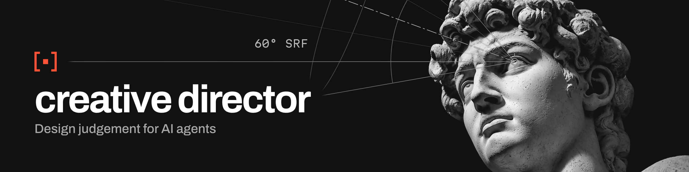

<p></p>

A set of design rules and a critique loop that any AI agent can read. It helps an agent judge and improve its own visual work (drawings, illustrations, 3D renders, web and app UI, UX flows, infographics, video): render it, look at it the way a designer would, cite a rule for every problem, make up to three small fixes, and stop when the work is clearly better. It stops agents inventing details nobody asked for (addresses, slogans, facts), breaking contrast and accessibility, and drifting from the brief, then an [energy pass](core/energy-pass.md) gives the work a focal hook, confident type and purposeful colour. Rules are grounded in perception research where it exists and in craft practice where it doesn't, and taste calls stay with the person who owns the work.

**[Gallery](https://snazzygaz.github.io/creative-director/gallery/)** · **[Install as Grok Bot](https://x.ai/bot/XWBKgRnDOw7uR5SpKx3Af)** · **[Claude Skill zip](https://github.com/SnazzyGaz/creative-director/releases/latest/download/creative-director-skill.zip)** · **[Lite version](lite/CREATIVE-DIRECTOR-LITE.md)**

<p><picture>
  <source media="(prefers-color-scheme: dark)" srcset="docs/assets/baseline-dark.jpg">
  
</picture></p>

Same prompt and image model, one sample each: an illustration, not a benchmark. *Without:* the prompt as is. *With:* the skill's loop, with every word set in code from the brief's facts only. *+ aesthetic layer:* one more round with the [aesthetic module](modules/aesthetic-critique/). [Full write-up](examples/baseline-comparison/) · [aesthetic notes](examples/aesthetic-benchmark/).

## Install

Works with any agent or LLM. [`docs/install.md`](docs/install.md) has the steps, with sources, for each one.

| Agent | Install |
|---|---|
| Grok Bot | One click: [Creative Director bot](https://x.ai/bot/XWBKgRnDOw7uR5SpKx3Af) |
| Hermes Agent | `hermes skills install SnazzyGaz/creative-director/skills/creative-director` |
| Claude Code, Codex, Cursor, Copilot, Devin, Cline | `gh skill install SnazzyGaz/creative-director creative-director --agent <agent>` (or `npx skills add SnazzyGaz/creative-director`) |
| Gemini CLI | `gemini skills install https://github.com/SnazzyGaz/creative-director.git --path skills/creative-director` |
| claude.ai, Claude desktop | Upload [`creative-director-skill.zip`](https://github.com/SnazzyGaz/creative-director/releases/latest/download/creative-director-skill.zip) in Customize > Skills ([steps](docs/install.md#claude)) |
| ChatGPT, Gemini Gems, Claude Projects, any chat LLM | Paste or upload [`creative-director-prompt.md`](https://github.com/SnazzyGaz/creative-director/releases/latest/download/creative-director-prompt.md) (about 9k tokens) or the [full bundle](https://github.com/SnazzyGaz/creative-director/releases/latest/download/creative-director-prompt-full.md) (about 63k) |
| Aider | `aider --read AGENTS.md` |

The skill is the [`skills/creative-director/`](skills/creative-director/) folder, in the open [Agent Skills](https://agentskills.io/specification) format. Inside a clone of this repo, agents read [`AGENTS.md`](AGENTS.md) directly or through a pointer file ([`CLAUDE.md`](CLAUDE.md), [`GEMINI.md`](GEMINI.md), [`.github/copilot-instructions.md`](.github/copilot-instructions.md), [`.cursor/rules/`](.cursor/rules/creative-director.mdc)). Every route leads back to `AGENTS.md`, and [`llms.txt`](llms.txt) is there for tools that read it.

## Usage

| Mode | What happens |
|---|---|
| **Self-check**<br>`+ creative director` | The agent runs the loop on its own output. Cheapest. |
| **Consult**<br>`consult creative director` | Send the brief and the real output; get back a neutral critique with ranked fixes ([template](core/critique-template.md)). |
| **Direct**<br>`creative director: direct this` | Joins at the start: writes the brief, sets direction, picks from rough options, reviews at checkpoints ([CD-1..6](core/creative-direction.md)). |
| **Remake from scratch**<br>"redo", "rejig", "start over", "reimagine" | Steps back first: what the piece is, who it is for, its one job, the feeling, the given facts (checked against each other) and what must survive. Sends a 5-8 line brief for sign-off, then 2-3 concepts that differ in structure, recommends one, builds it and runs the full checks ([FP-1..9](core/first-principles.md), [example](examples/first-principles-remake/)). Without these words the light touch stays the default. |
| **Nudge**<br>"bolder", "quieter", "distill" | Bolder adds contrast, scale difference and commitment; quieter lowers whatever competes with the main thing; with a lookbook look applied, each moves its strength one step. Distill removes until the one job still works, and no further ([commands](core/commands.md)). The *Sitting right* guard still applies, so none of them centres things by default. |

Always send the actual output (image, screenshot at real size, URL or renders), never a description. Interactive and 3D work is reviewed hands-on: clicked, panned, zoomed and recorded, then judged on how it feels to use, not from stills alone. Video is watched in motion at its delivered size with sound, then scrubbed and sampled frame by frame ([film module](modules/film/review.md)).

## Modules

[`core/`](core/) is always loaded (principles and the loop); the agent picks modules for the job ([`core/which-modules.md`](core/which-modules.md)).

| Module | Covers |
|---|---|
| [technical-drawing](modules/technical-drawing/) · [illustration](modules/illustration/) · [character](modules/character/) | perspective, light, anatomy (every hand, limb and face checked; a fail blocks delivery) |
| [web-ui](modules/web-ui/) · [ux](modules/ux/) · [3d](modules/3d/) | screens, flows and accessibility, clicked and recorded; 3D build defects |
| [typography](modules/typography/) · [layout](modules/layout/) · [brand](modules/brand/) | type, social cards, posters, slides, print, infographics with charts drawn from the data in code; official logos only, never redrawn |
| [composition](modules/composition/) · [colour-value](modules/colour-value/) · [aesthetic-critique](modules/aesthetic-critique/) | balance, focus, beauty and palette, graded from *well supported* to *myth*; intent model and side-by-side verdicts |
| [film](modules/film/) (optional) | story first: shots, continuity, light, grading, editing, sound, generated-video QC |
| [lookbook](modules/lookbook/) (optional) | 320 visual looks to offer as directions, named by technique or era, never by living artists |

Also: a [font library](fonts/) of 61 free families in 18 themes, and [`tools/`](tools/) for every measurable check (one-command auto check, contrast, vanishing points, ellipses, layout grid, chart and route drawing).

## How it works

<p><picture>
  <source media="(prefers-color-scheme: dark)" srcset="docs/assets/loop-dark.png">
  
</picture></p>

Each rule has an ID (`CORE-2`, `TD-PER-1`, `UI-6`) and the same parts: what, why, a check you can run, the usual fix, an honest evidence grade, and a source. Only **MUST-BE-RIGHT** errors (perspective, anatomy, light, contrast and accessibility, broken flows, 3D build defects) block; everything else is a default. Any picture with a person, hand or animal also gets an anatomy pass: every hand, limb and face is cropped and checked one by one (count, trace to the shoulder, grip, joints), and a fail blocks delivery ([CHAR-9](modules/character/README.md#char-9-anatomy-pass-crop-trace-count-must-be-right-delivery-gate)). Full loop: [`core/critique-loop.md`](core/critique-loop.md).

Passing the rules makes work correct, not necessarily good, so the [composition](modules/composition/), [colour-value](modules/colour-value/) and [aesthetic](modules/aesthetic-critique/) modules and the [energy pass](core/energy-pass.md) handle the rest, and a *Sitting right* pass flags placement that looks accidental without pushing work toward centring. **Handing over work with no specific ask** gets a short, ranked list of changes, and nothing changes until you sign off ([`core/interaction-flow.md`](core/interaction-flow.md)).

## Examples

<details><summary>Three more before/after pairs</summary>

<p><picture>
  <source media="(prefers-color-scheme: dark)" srcset="docs/assets/before-after-dark.jpg">
  
</picture></p>

Generated, one or two rounds each.
</details>

Take-overs of bad work, nudges, one small case per common agent failure and the baseline above, all with critiques, logs and honest misses: [examples/](examples/), or the [gallery](https://snazzygaz.github.io/creative-director/gallery/). The [cross-model kit](examples/cross-model/) tests it on other models.

## Blind test

The owner of the work judged with-skill and plain-prompt images side by side without knowing which was which: over 100 briefs the skill won 59 to 40 with one tie (one-sided sign test p = 0.035), meeting the 59-of-100 bar set in advance, so a clear result. It leads on pictures, logos and packaging and is behind on screens and infographics. One judge, and later batches were not independent of the rule-writing, so read it as one person's taste, not research. Batches, keys and caveats: [`examples/blind-test/RESULTS.md`](examples/blind-test/RESULTS.md).

## Requirements

- **Vision.** The agent has to *see* its output: a model that accepts images.
- **A way to render or screenshot** the work at real size: a browser for UI, a renderer for 3D, the image file for pictures.
- **Recommended setup:** Playwright or headless Chrome for UI (`tools/shot.sh` uses Chrome; `tools/autocheck.py` uses Playwright for pages), Blender for 3D (plus [model-qa](https://github.com/SnazzyGaz/model-qa) for build checks), and Python 3 with Pillow and NumPy for the `tools/` scripts (the auto check, look tests, contrast, vanishing points, ellipses, layout grid, 3D intersections; `pip install -r tools/requirements.txt`).
- **Without vision** you only get a rules-only review of code or a description. It can still catch contrast, spacing and flow problems in code, but it can't judge how the work looks, and it is much weaker.

Context cost: about 6,400 tokens always loaded (`AGENTS.md`, principles and the loop; 7,800 with the critique template), plus 1,200-5,800 per module README, with bigger modules split into on-demand files (film: about 10,300 for its three core files) ([table](core/which-modules.md#token-cost-per-module)). Budgets are enforced in CI (`tools/check_budgets.py`). For small context windows, [`lite/CREATIVE-DIRECTOR-LITE.md`](lite/CREATIVE-DIRECTOR-LITE.md) has the loop, core rules and blockers in about 2,300 tokens.

## What's inside

```
core/       always: principles, the loop (with sign-off and delivery). On demand: critique template,
            creative direction, first-principles remake, brand intake, evidence, module picker
modules/    technical-drawing · illustration · character · web-ui · ux · 3d
            typography · layout (social, posters, slides, print) · brand · aesthetic-critique
            composition (balance, focus, unity, space, beauty) · colour-value
            film (cinematography and video, story first: shots, continuity, light, grading, editing, sound, generated-video QC)
            lookbook (optional: 320 established looks and wildcards, tag file and image sheets)
tools/      auto check (one command, every measurable rule), look tests, WCAG contrast, screenshots, vanishing points, ellipses, layout grid, whitespace, balance, 3D intersections, before/after
examples/   stress tests, round by round, including this README's own critique
fonts/      61 free font families in 18 themes, catalogue and specimen sheets
lite/       the loop, core rules and blockers in one short file
skills/     the installable skill folder, generated from the files above
docs/       gallery, README images, reference library, design notes (DECISIONS.md, PROPOSED-REPO.md)
```

## Principles of the critique

- **Neutral.** Factual, like a thesis supervisor. No praise padding, no harshness.
- **Rule-cited.** Every point names a rule ID and the evidence. No rule, no point; it becomes a question for the owner.
- **Light touch.** Keep the intent and what already works. At most three fixes a round, then stop when clearly better.
- **Take over when broken.** If the construction is fundamentally wrong, rework it, then re-check it still answers the brief.

This README went through the loop too: [examples/readme-self-critique](examples/readme-self-critique/).

## Sources and evidence

Every rule cites its sources in [SOURCES.md](SOURCES.md); what the research supports, and the myths to stop repeating, are in [core/evidence.md](core/evidence.md).

## Licence

MIT, see [LICENSE](LICENSE). Cited works stay with their authors; this repo paraphrases and links to them. The lookbook's `getty_aat` era terms come from the Getty Art & Architecture Thesaurus (AAT), J. Paul Getty Trust, under ODC-By 1.0 ([S266](SOURCES.md)).
