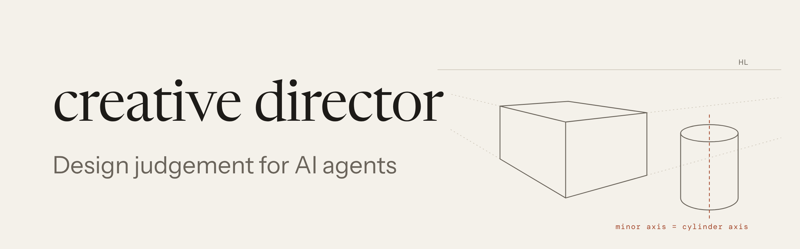
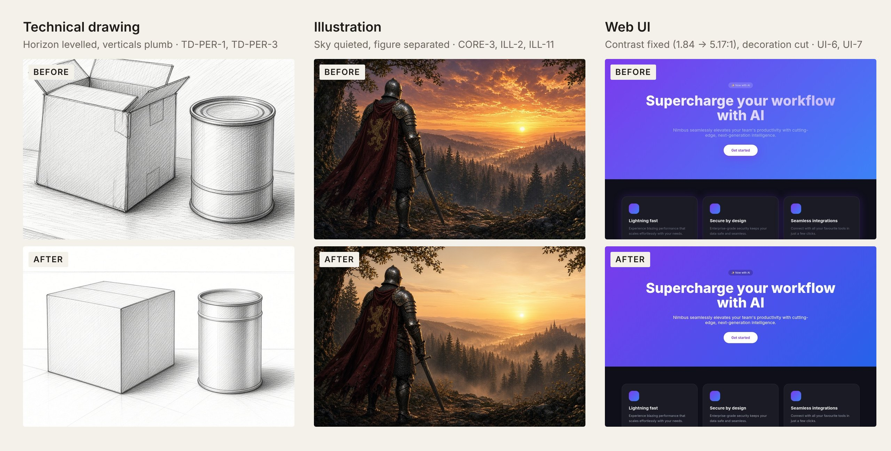
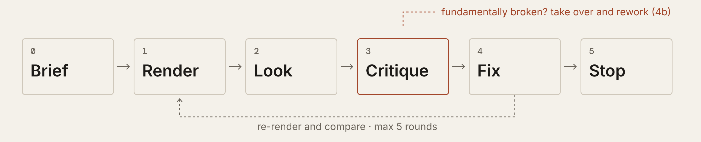

<p><picture>
  <source media="(prefers-color-scheme: dark)" srcset="docs/assets/banner-dark.png">
  
</picture></p>

**What it gives an agent is restraint and accuracy, not flair.** It stops agents inventing details nobody asked for (addresses, slogans, facts), breaking contrast and accessibility, and drifting from the brief, and it makes them render and measure their own work before calling it done. It won't make work more exciting by itself: in the test below, the versions made without it are more vivid at a glance. They are also the ones with invented facts.

**[Gallery](https://snazzygaz.github.io/creative-director/gallery/)** · **[Install as Grok Bot](https://x.ai/bot/XWBKgRnDOw7uR5SpKx3Af)** · **[Claude Skill zip](https://github.com/SnazzyGaz/creative-director/releases/latest/download/creative-director-skill.zip)** · **[Lite version](lite/CREATIVE-DIRECTOR-LITE.md)**

<p><picture>
  <source media="(prefers-color-scheme: dark)" srcset="docs/assets/baseline-dark.jpg">
  
</picture></p>

Same prompt, same image model (Grok Bot's built-in GenerateImage), one sample each, so an illustration, not a benchmark. *Without:* the prompt as is; the model lettered its own text and invented a subtitle, signs, slogans and an address. *With:* the skill's loop; art generated without text, then every word set in code from the brief's facts only (the cover's author is a marked placeholder), three rounds each. The with-skill versions win on accuracy, hierarchy and legibility, and lose on first-impression energy and atmosphere. *+ aesthetic layer:* one more round with the [aesthetic module](modules/aesthetic-critique/) (new text-free art, same facts and type in code, contrast re-checked). It wins back warmth and atmosphere, but in Grok Bot's own judgement on one sample each, and with one more round of work than the middle column. **Fixed after review:** two lighting faults that broke the repo's own blocker (TD-LIT-1, one key light). In the aesthetic poster the bass stood outside the lamp's cone yet was brightly lit, and had a violin's outline; after two failed edits a third put it in the lamp's light, lit from the lamp side, with a double bass's sloped shoulders. In the middle fox cover the open book glowed and lit the face from below; one edit made it plain paper. The aesthetic fox was also re-made to remove a robin and fireflies the brief never asked for. Every hero image with a character then had an anatomy pass (CHAR-9/10): all pass ([sweep](examples/anatomy-sweep/)). Self-judged. [Full write-up](examples/baseline-comparison/) · [aesthetic notes](examples/aesthetic-benchmark/).

A set of design rules and a critique loop that any AI agent can read. It helps an agent judge and improve its own visual work (drawings, illustrations, 3D renders, web and app UI, UX flows): render it, look at it the way a designer would, cite a rule for every problem, make up to three small fixes, and stop when the work is clearly better. Rules are grounded in perception research where it exists and in craft practice where it doesn't, and taste calls stay with the person who owns the work.

## Install

**Grok Bot.** One click: [Creative Director bot](https://x.ai/bot/XWBKgRnDOw7uR5SpKx3Af). Or point any bot at [`AGENTS.md`](AGENTS.md).

**Claude.** Download [`creative-director-skill.zip`](https://github.com/SnazzyGaz/creative-director/releases/latest/download/creative-director-skill.zip) (about 270 KB: `SKILL.md`, `core/`, `modules/`, `lite/`, `tools/`, the font catalogue; no images, font files or examples; built by [`tools/package_skill.py`](tools/package_skill.py)). The zip has the `creative-director/` folder at its top level, as Claude requires.
- **claude.ai:** first turn on *Code execution and file creation* in Settings > Capabilities (skills need it). Then, as [Anthropic's guide](https://support.claude.com/en/articles/12512180-use-skills-in-claude) describes: go to Customize > Skills, click **+**, then **+ Create skill**, choose **Upload a skill**, and upload the zip. Toggle it on in the skills list. On Team and Enterprise plans an owner may need to allow skills first (see the guide).
- **Claude Code:** `unzip creative-director-skill.zip -d ~/.claude/skills/` (or `.claude/skills/` inside a project).
- **Claude Projects:** unzip, then add `creative-director/SKILL.md`, `core/principles.md`, `core/critique-loop.md`, `core/critique-template.md` and the modules you need as project knowledge.

**Other tools.**

| Tool | Entry point |
|---|---|
| Cursor | [`.cursor/rules/creative-director.mdc`](.cursor/rules/creative-director.mdc), [`AGENTS.md`](AGENTS.md) |
| Claude Code, Claude Skills | Skill zip (above), [`CLAUDE.md`](CLAUDE.md), [`SKILL.md`](SKILL.md) |
| Codex, Gemini CLI, Jules | [`AGENTS.md`](AGENTS.md) |
| GitHub Copilot | [`.github/copilot-instructions.md`](.github/copilot-instructions.md) |
| ChatGPT, Gemini Gems, Claude Projects | Upload `AGENTS.md`, `core/principles.md`, `core/critique-loop.md`, `core/critique-template.md` and the modules you need as knowledge |

Every entry point leads back to `AGENTS.md`, and [`llms.txt`](llms.txt) is there for tools that read it.

## Examples

<details><summary>Three more before/after pairs</summary>

<p><picture>
  <source media="(prefers-color-scheme: dark)" srcset="docs/assets/before-after-dark.jpg">
  
</picture></p>

Generated, one or two rounds each.
</details>

Example sets across every domain: four take-overs of deliberately bad work, nudges, one small case per common agent failure, the baseline above and an aesthetic demo, all with critiques, logs and honest misses: [examples/](examples/), or filter them in the [gallery](https://snazzygaz.github.io/creative-director/gallery/). To test it on another model, the [cross-model kit](examples/cross-model/) has the inputs, prompts and scoring. There are two outside pilot runs so far, [Claude Opus 5.5 and ChatGPT GPT-6](examples/cross-model/runs/), both contaminated (the models had read the answer keys), so they score nothing. What they suggest: without the skill the models already found most faults; with it, the critiques were better structured (blockers first, rule IDs, brief kept), and where the tools were run they gave measurements instead of guesses. A clean, blind run is still wanted.

## How it works

<p><picture>
  <source media="(prefers-color-scheme: dark)" srcset="docs/assets/loop-dark.png">
  
</picture></p>

Each rule has an ID (`CORE-2`, `TD-PER-1`, `UI-6`) and the same parts: what, why, a check you can run, the usual fix, an honest evidence grade, and a source. Only **MUST-BE-RIGHT** errors (perspective, anatomy, light, contrast and accessibility, broken flows, 3D build defects) block; everything else is a default. Any picture with a person, hand or animal also gets an anatomy pass: every hand, limb and face is cropped and checked one by one (count, trace to the shoulder, grip, joints), and a fail blocks delivery ([CHAR-9](modules/character/README.md#char-9-anatomy-pass-crop-trace-count-must-be-right-delivery-gate)). Full loop: [`core/critique-loop.md`](core/critique-loop.md).

### Correctness and quality

Passing the rules makes work correct, not necessarily good. For composition and beauty, [`modules/composition/`](modules/composition/) and [`modules/colour-value/`](modules/colour-value/) gather what the classic design books, East Asian aesthetics and a century of empirical aesthetics agree on, with every rule graded *well supported*, *partly supported*, *craft wisdom* or *myth* ([annotated bibliography](BIBLIOGRAPHY.md)). Before delivery, a *Sitting right* pass asks "does anything sit weirdly?". It flags only balance and placement that look accidental (near-misses, floating or crammed elements, tangents, near-alignments, uneven gutters, dead space) and asks "intended?". It never pushes work toward symmetry or centring. The [aesthetic layer](modules/aesthetic-critique/) adds an intent model, side-by-side verdicts instead of scores, and one-or-two-change revisions that re-run the measured checks and may restyle but not add story content. Examples: the [reference set](examples/aesthetic-benchmark/reference-set/) (12 pieces, self-made and self-judged, so a showcase, not evidence); and [one worked example per domain](examples/aesthetic-across-domains/): illustration, technical drawing, web page, app flow, poster, 3D product shot and data chart, each with its critique and an after with every point applied.

<details><summary>More on the aesthetic layer</summary>

In the [baseline](examples/baseline-comparison/) the with-skill poster won on accuracy and legibility but lost on atmosphere; the aesthetic layer is the answer to that. It starts from an intent model (purpose, audience, mood, style, polish), with each line marked as stated or guessed. It judges versions side by side for the brief ("which is stronger, why, at what cost"), not by adding up scores. It changes one or two aesthetic things at a time and re-runs the measured checks, so a mood gain can't hide a regression. It may restyle light, palette, composition, texture and type, but may not add characters, objects, text or claims the brief didn't give without the owner's say-so. Critiques keep **measured** findings (checked with a tool; only these block) apart from **interpreted** ones (aesthetic readings, labelled as such). A [reference library](docs/references.md) of 27 public works and a [test protocol](examples/aesthetic-benchmark/) come with it. In every comparison so far the aesthetic version had one more round of work than the rules-only one; the protocol now requires equal rounds.
</details>

## Usage

| Mode | What happens |
|---|---|
| **Self-check**<br>`+ creative director` | The agent runs the loop on its own output. Cheapest. |
| **Consult**<br>`consult creative director` | Send the brief and the real output; get back a neutral critique with ranked fixes ([template](core/critique-template.md)). |
| **Direct**<br>`creative director: direct this` | Joins at the start: writes the brief, sets direction, picks from rough options, reviews at checkpoints ([CD-1..6](core/creative-direction.md)). |
| **Remake from scratch**<br>"redo", "rejig", "start over", "reimagine" | Steps back first: what the piece is, who it is for, its one job, the feeling, the given facts (checked against each other) and what must survive. Sends a 5-8 line brief for sign-off, then 2-3 concepts that differ in structure, recommends one, builds it and runs the full checks ([FP-1..9](core/first-principles.md), [example](examples/first-principles-remake/)). Without these words the light touch stays the default. |

Always send the actual output (image, screenshot at real size, URL or renders), never a description.

**Handing over work with no specific ask** gets a short, ranked list of the changes that matter, each tied to a rule and marked *edit* or *regenerate*, and nothing changes until you sign off. Then every signed-off point is applied and checked, and the result comes back with a done / not done line per point. Say "just fix it" to skip the sign-off. Flow and diagram: [`core/interaction-flow.md`](core/interaction-flow.md).

**Logos and marks:** the official file goes in (from the owner, the brand's own site or Wikimedia Commons, checked against the brand), unaltered and at good quality. A mark is never redrawn, restyled or AI-generated, and generated images are checked for invented logos on jerseys, bottles and signs ([BRAND-4, BRAND-8](modules/brand/README.md)).

**Type:** a [font library](fonts/) of 61 free families (SIL OFL or Apache) grouped into 18 themes, from editorial serif to horror to nautical, with a [catalogue](fonts/CATALOGUE.md) and specimen sheets, so type matches the brief's genre instead of repeating one face.

## Requirements

- **Vision.** The agent has to *see* its output: a model that accepts images.
- **A way to render or screenshot** the work at real size: a browser for UI, a renderer for 3D, the image file for pictures.
- **Recommended setup:** Playwright or headless Chrome for UI (`tools/shot.sh` uses Chrome; `tools/autocheck.py` uses Playwright for pages), Blender for 3D (plus [model-qa](https://github.com/SnazzyGaz/model-qa) for build checks), and Python 3 with Pillow and NumPy for the `tools/` scripts (the auto check, look tests, contrast, vanishing points, ellipses, layout grid, 3D intersections; `pip install -r tools/requirements.txt`).
- **Without vision** you only get a rules-only review of code or a description. It can still catch contrast, spacing and flow problems in code, but it can't judge how the work looks, and it is much weaker.

Context cost: about 6,300 tokens always loaded (`AGENTS.md`, principles and the loop; 7,700 with the critique template), plus 1,900-8,800 per module ([table](core/which-modules.md#token-cost-per-module)). For small context windows, [`lite/CREATIVE-DIRECTOR-LITE.md`](lite/CREATIVE-DIRECTOR-LITE.md) has the loop, core rules and blockers in about 2,900 tokens.

## What's inside

```
core/       always: principles, the loop (with sign-off and delivery). On demand: critique template,
            creative direction, first-principles remake, brand intake, evidence, module picker
modules/    technical-drawing · illustration · character · web-ui · ux · 3d
            typography · layout (social, posters, slides, print) · brand · aesthetic-critique
            composition (balance, focus, unity, space, beauty) · colour-value
            lookbook (optional: 196 established looks and wildcards, tag file and image sheets)
tools/      auto check (one command, every measurable rule), look tests, WCAG contrast, screenshots, vanishing points, ellipses, layout grid, whitespace, balance, 3D intersections, before/after
examples/   stress tests, round by round, including this README's own critique
fonts/      61 free font families in 18 themes, catalogue and specimen sheets
lite/       the loop, core rules and blockers in one short file
docs/       gallery, README images, reference library, design notes (DECISIONS.md, PROPOSED-REPO.md)
```

## Principles of the critique

- **Neutral.** Factual, like a thesis supervisor. No praise padding, no harshness.
- **Rule-cited.** Every point names a rule ID and the evidence. No rule, no point; it becomes a question for the owner.
- **Light touch.** Keep the intent and what already works. At most three fixes a round, then stop when clearly better.
- **Take over when broken.** If the construction is fundamentally wrong, rework it, then re-check it still answers the brief.

This README went through the loop too: [examples/readme-self-critique](examples/readme-self-critique/).

## Sources and evidence

Every rule cites its sources in [SOURCES.md](SOURCES.md); what the research supports, and the myths to stop repeating, are in [core/evidence.md](core/evidence.md).

## Licence

MIT, see [LICENSE](LICENSE). Cited works stay with their authors; this repo paraphrases and links to them. The lookbook's `getty_aat` era terms come from the Getty Art & Architecture Thesaurus (AAT), J. Paul Getty Trust, under ODC-By 1.0 ([S266](SOURCES.md)).
