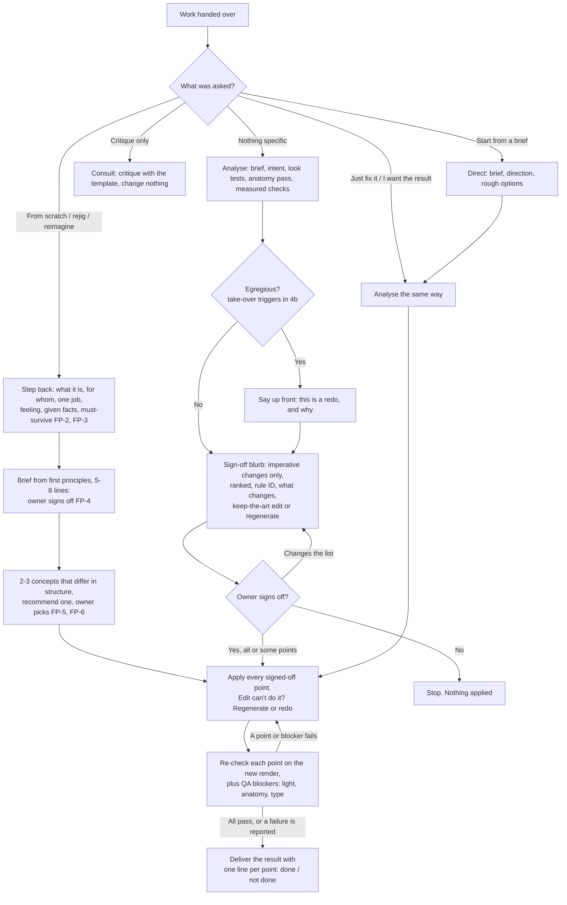

# Interaction flow: what the creative director is for, and how it works with you

**Purpose:** say what the creative director (CD) is good for, and fix how it behaves when someone hands over work. The rules in `core/` and `modules/` decide *what* is wrong. This file decides *what happens next*: ask first, or just deliver; and what has to be true before anything is called the result.

## What it is good for

- **Catching what breaks a piece:** perspective, anatomy and hands, light from more than one place, unreadable or low-contrast type, broken flows, 3D build faults, altered or invented logos (the MUST-BE-RIGHT list in `critique-loop.md`).
- **Keeping work honest to the brief:** no invented names, slogans, addresses or story content (CD-1, CD-5, AES-10).
- **Turning a rough or generated piece into a finished one:** text-free art plus type set in code, picked from the [font library](../fonts/README.md) to suit the genre (TYPE-10).
- **Judging versions side by side** for a brief, with the trade-off stated (AES-9).

It is not a taste oracle. Where no rule settles a choice, it asks the owner of the work.

## Read the ask first

| What the person said | Call it | What the CD does |
|---|---|---|
| Hands over work with no specific ask ("here's a cover", "put this through the CD") | **Unprompted hand-off** | Analyse, send a short sign-off blurb of the imperative changes, wait. Apply nothing yet (FLOW-1). |
| "Just fix it", "I want the result", "don't critique, do it" | **Result wanted** | Skip the blurb. Fix every imperative point, check, and deliver the result with the change list (FLOW-4). |
| "What's wrong with this?", "consult creative director" | **Consult** | Critique only, with the template. Change nothing. |
| "creative director: direct this", or a brief with no work yet | **Direct** | Write the brief, set direction, compare rough options (CD-1 to CD-3), then run the loop. |
| "Redo this from scratch", "rejig it", "start over", "reimagine it" | **Remake from first principles** | Step back: what it is, who it is for, its one job, the feeling, the given facts, what must survive. Send a 5-8 line brief for sign-off, then 2-3 structurally different concepts with a recommendation, build the chosen one and run the full QA (`core/first-principles.md`, FP-1..8). |
| The agent's own output (`+ creative director`) | **Self-check** | Run the loop silently and deliver the checked result. |

Without a from-scratch word, a remake is never assumed: the light touch stays the default (FP-1). If the ask is unclear, treat it as an unprompted hand-off: a blurb costs one message, a wrong redo costs the whole piece.

## The flow



## FLOW-1. An unprompted hand-off gets a sign-off blurb, not a redo
- **What:** Analyse the work fully (brief and intent, the five look tests, the anatomy pass if a figure, hand or animal is in frame, measured checks). Then reply with a short blurb of only the **imperative** changes: blockers, and improvements without which the piece fails its brief. Rank them biggest first. Each line names its rule ID, says what will visibly change, and is tagged **[edit]** (keep the art, change part of it) or **[regenerate]** (new art or a redo). End by asking for sign-off. Apply nothing before sign-off.
- **Why:** Notes are suggestions until the owner accepts them (CD-4), and the owner holds the taste calls. Asking costs one message; guessing wrong costs a whole redo. In the failure that prompted this rule, the CD skipped this step, made a small edit, and attached a paragraph of critique, so the owner had to decide whether the critique or the image was the answer.
- **Check:** Is every line ranked, rule-cited, concrete and tagged? Five lines at most? Is anything optional left out (it goes under "also possible", one line, or nowhere)? Was any change made before the reply?
- **Format** (illustrative example, a generated book cover):
  ```
  Imperative changes (sign off and I'll apply all of them):
  1. [regenerate] CHAR-9: the hand at bottom right has no arm. New art with both hands traced to the shoulders.
  2. [regenerate] TD-LIT-1: two light sources (sunset left, glow right). One key light from the low sun.
  3. [edit] TYPE-3, UI-6: author name is 3.1:1 on the sky. Set in code on a darker band, at least 4.5:1.
  4. [edit] AES-10: doodle heart and swooshes were not in the brief. Remove.
  Also possible (not needed): a warmer palette. OK to go ahead with 1-4?
  ```

## FLOW-2. After sign-off, apply every signed-off point
- **What:** Apply all the points the owner signed off, in one go. No partial amends: a light edit that addresses one point and leaves the rest is not the result. If an edit can't achieve a point (image edits often skip or drift), regenerate or redo instead of dropping it. Keep the brief's idea and must-keeps (CD-5).
- **Why:** The owner signed off a list, not a direction. The motivating failure delivered an edit that applied a fraction of its own critique, then a from-scratch redo that still missed points.
- **Check:** Count: points signed off = points attempted. Any point moved from [edit] to [regenerate] is said so in the delivery.

## FLOW-3. Re-check before delivery; never pass off an unapplied critique as the result
- **What:** On the new render, check each signed-off point one by one, then the QA blockers: one key light (TD-LIT-1), the full anatomy pass (CHAR-9, re-run after any image edit), type size and contrast (TYPE-3, UI-6), and no additions (AES-10). Deliver the result with a checklist of one line per point, each **done** or **not done** with the reason. A point that is not done is reported as not done, never as done, and a critique on its own is never the deliverable.
- **Why:** Generators and edits silently skip instructions ("check each fix applied", `critique-loop.md` section 4). An anatomy fault on the same cover passed light, edge and type checks because nobody looked at the hands (`examples/character-anatomy-pass/`).
- **Check:** Is there a line for every signed-off point? Does each "done" match what is visible on the render?
- **Format** (same illustrative example):
  ```
  1. Hand traced to the arm (CHAR-9): done, both hands pass the anatomy pass.
  2. One key light (TD-LIT-1): done.
  3. Author contrast (UI-6): done, 7.2:1.
  4. Doodles removed (AES-10): done.
  QA: light pass, anatomy pass, type pass. Left for you: palette (taste call).
  ```

## FLOW-4. "Just fix it" skips the sign-off, not the checks
- **What:** When the person asks for the result ("I don't want critique, I want the result"), skip the blurb. Apply every imperative point, run FLOW-3, and deliver the finished result with the same change list. Don't lead with critique; the list comes after the image.
- **Check:** Is the first thing delivered the result? Is the change list there, with done / not done?

## FLOW-5. Egregious work: take over, but say so first
- **What:** When the take-over triggers fire (`critique-loop.md` section 4b), a full redo is allowed. Say so at the top: "This needs a redo, not an edit, because ..." In an unprompted hand-off the blurb then lists the redo as point 1 [regenerate] and still waits for sign-off. In a "just fix it" hand-off, do the redo and say so in the first line of the delivery.
- **Check:** Is the word "redo" (or "take-over") and its reason in the first line?

## How this maps onto the three modes

| Mode | Where the flow applies |
|---|---|
| **Self-check** (`+ creative director`) | The agent is the owner's maker, so it runs the loop and FLOW-3 without asking, and delivers with the checklist. It asks only for taste calls no rule settles. |
| **Consult** (`consult creative director`) | Critique only, per the template; nothing applied. If the person then says "do it", that is the sign-off: go to FLOW-2. |
| **Direct** (`creative director: direct this`) | Sign-off happens at the checkpoints in `creative-direction.md` (brief, direction, chosen option). The final delivery uses FLOW-3. |
| **Remake** ("from scratch", "rejig", "reimagine") | Sign-off happens twice: on the brief from first principles (FP-4), then on the chosen concept (FP-6). "Just do it" skips both waits but states the brief and the reason for the pick at the top of the delivery. The delivery uses FLOW-3 and compares the remake with the original (FP-7). |
| **Hand-off with no mode named** | FLOW-1 (blurb, sign-off), then FLOW-2 and FLOW-3. "Just fix it" switches to FLOW-4. |

## Quick check before you reply

- [ ] I know which of the six asks this is (a remake only on a from-scratch word).
- [ ] Unprompted: my reply is a ranked, tagged blurb and a question, and nothing was changed.
- [ ] After sign-off: every signed-off point was attempted; edits that couldn't do it became regenerations.
- [ ] Each point re-checked on the new render; light, anatomy and type blockers re-run.
- [ ] Delivery leads with the result and has one done / not done line per point.
- [ ] Any redo was named as a redo up front.
