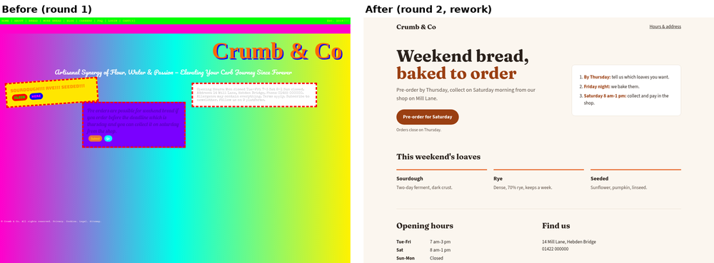
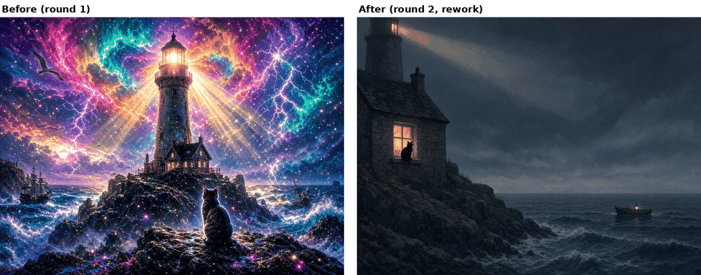
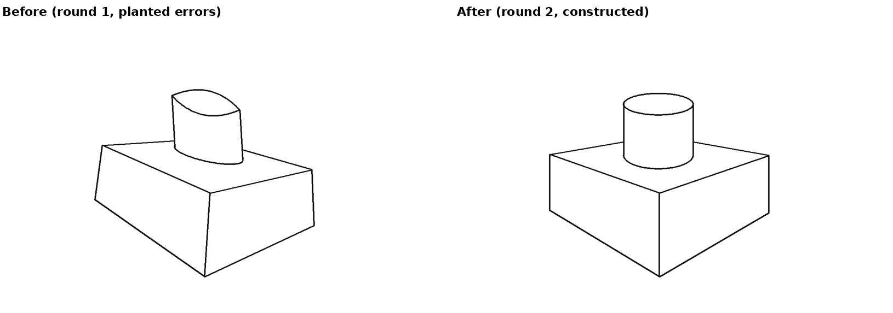
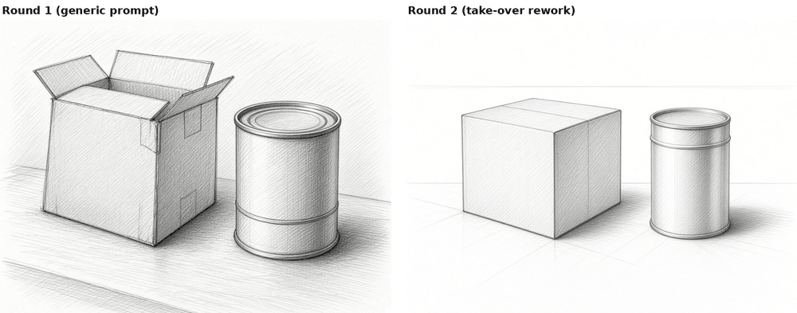
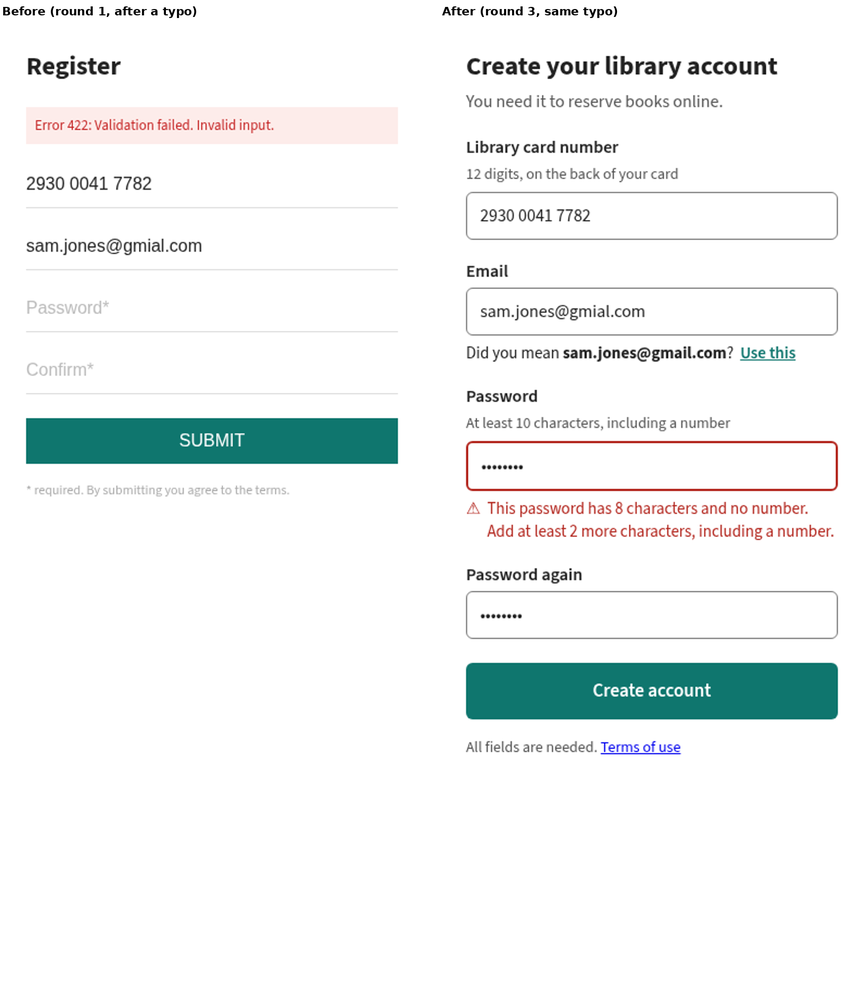
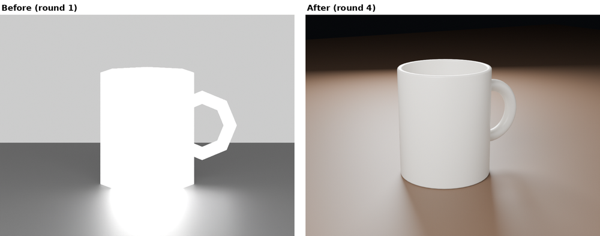
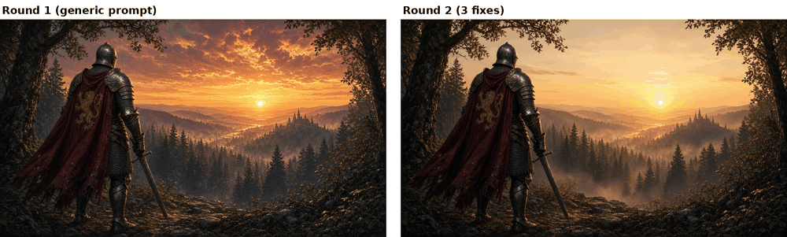
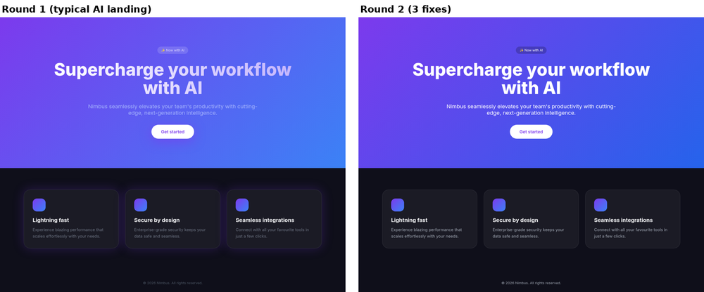

# Examples: stress tests

Runs of the critique loop (`core/critique-loop.md`) done as a bot would: brief, render, five look tests, a rule-cited critique, at most three fixes per round (no cap in a take-over), check each fix applied, stop when clearly better. Each folder has the brief (or states it in the first critique), every round, the critiques (`critique-rNN.md`) and a short `log.md` that includes what went wrong.

**How each was made** is stated in its folder and repeated in the table. Some starting pieces were made badly *on purpose* to test the take-over path; they are labelled as such. Nothing here is third-party work.

## What was detected and what was fixed

| Example | Domain | Made with | Nudge or take-over | Key rule IDs detected | What was fixed | Rounds |
|---|---|---|---|---|---|---|
| [web-ui-takeover](web-ui-takeover/) | Web UI | Hand-built bad HTML, headless Chrome | **Take-over** (3 blockers) | UX-1, UI-6 (11/11 pairs fail, worst 1.13:1), UI-10, UI-1 (6 fonts), CORE-1 | Rebuilt from the brief: tokens, 2 typefaces, one-column flow, one real action. All pairs pass (min 6.31:1) | 2 |
| [illustration-takeover](illustration-takeover/) | Illustration / generative image | GenerateImage (AI) | **Take-over** | TD-LIT-1, ILL-2, CORE-3, ILL-11 (rainbow sky, sparkles, god rays), ILL-6, CD-5 (wrong boat) | Regenerated with composition, value plan, palette and one light written in. Round-3 edit (cat's pose, beam) did not apply; delivered round 2 | 3 |
| [technical-drawing-takeover](technical-drawing-takeover/) | Technical drawing | Synthetic line drawing from code, errors planted | **Take-over** (5 blockers) | TD-PER-1 (VPs 200 px apart), TD-PER-3 (verticals -7.6 to +2.3 deg), TD-ELL-1 (~19 deg off), TD-ELL-2, TD-ELL-3 | Redrawn by construction: one horizon, true verticals, tin on the lid's diagonals. All tool checks pass. ellipse.py missed the planted lemon shape | 2 |
| [technical-drawing-still-life](technical-drawing-still-life/) | Technical drawing | GenerateImage (AI) | **Take-over** | TD-PER-1, TD-PER-3 | Regenerated with construction in the prompt. Correct, but lost the open box (led to CD-5) | 3 |
| [ux-signup-nudge](ux-signup-nudge/) | UX flow | Hand-built HTML form states | Nudge (1 blocker) | UI-6 (placeholder labels 1.92:1), UX-3 ("Error 422", input cleared), UX-6, UX-7 | Real labels and borders; rule up front; inline error that says how to fix and keeps input; plain wording; email typo suggestion | 3 |
| [3d-mug-nudge](3d-mug-nudge/) | 3D | Blender 4.2 Cycles renders from a script | Nudge (0 blockers) | 3D-7 (24.2% clipped), 3D-6 (albedo 255, metal 0.5), 3D-4 (8 sides, flat), 3D-5 (frontal light) | AgX; plausible materials; smooth + bevel; key/fill/rim, dark backdrop, raised camera; lights re-balanced. 0% clipped | 4 |
| [illustration-knight](illustration-knight/) | Illustration | GenerateImage (AI) | Nudge | CORE-3, ILL-2, ILL-3, CORE-2 | Simpler sky, mist behind the legs; rim light did not apply | 2 |
| [web-ui-landing](web-ui-landing/) | Web UI | Generated HTML, headless Chrome | Nudge (1 blocker) | UI-6 (6 pairs, worst 1.84:1), UI-7 (8 tells), UI-2 at 200% | Contrast tokens; less decoration; cards stack at zoom. Still generic: needs a brand brief | 2 |
| [readme-self-critique](readme-self-critique/) | Web UI (docs page) | This repo's README, headless Chrome | Nudge (1 blocker) | CORE-10 (banner text unreadable on a phone), spacing, tables | Phone-size assets; spacing and table fixes | 2 |
| [common-failures](common-failures/) | Web UI, technical drawing, 3D | Code-built panels, SVG, Blender 4.2 | Single-round fixes | UI-3/CORE-4 spacing, CORE-5/UI-4 grid, UI-1/CORE-7 type, CORE-9/UI-5 icons, TD-PER-1 (tilt 8.26 deg), 3D-1 (12 mm float, leg through seat) | One small case per common agent failure; each fix checked (vp.py 0.02 deg; model-qa PASS) | 1 each |
| [baseline-comparison](baseline-comparison/) | Illustration, poster | GenerateImage, same prompt with and without the skill | Baseline | CD-1/CORE-8 (invented title, address, slogans), ILL-2, UI-1 (4 type styles) | Skill version kept only given facts and one focal point; plainer, and one glow shape failed | 1 |
| [layout-social-card](layout-social-card/) | Layout / social | The repo's own X card, measured with Python | Critique only (0 blockers) | LAY-6/TYPE-3 (proof-point caption about 2 px x-height at feed size), LAY-2 (bottom margin 6.8% vs sides 12.4%), LAY-5 (reuse crops) | Not changed: findings left for the next version | 1 |
| [typography-scale](typography-scale/) | Typography | Re-judging the common-failures type case | Single-round fix | TYPE-1 (5 families), TYPE-2 (31 vs 29 px, ratio 1.07), TYPE-7 | 2 families; sizes 36/24/17/14 (ratios ≥ 1.21) | 1 |
| [brand-intake](brand-intake/) | Brand | Intake run on the web-ui-landing case, no-answer mode | Step 0 | UI-7 (5 tells left after 2 rounds), BRAND-7 | Assumed token sheet (all roles pass contrast); 2 of 5 tells answerable, 3 need the owner's facts | 0 (intake) |
| [character-hands](character-hands/) | Character / generative image | GenerateImage (AI), zoom audit at 2x | Check only (0 blockers) | CHAR-3, CHAR-4, CHAR-7 all pass; CHAR-3 note (hand about 1.15× face length) | Nothing to fix; the generator passed | 1 |

## Take-overs

### Web UI: "Crumb & Co" bakery page (take-over, 2 rounds)

Built badly on purpose: six typefaces, clashing gradient, absolute layout, buttons that go nowhere. Three MUST-BE-RIGHT failures fired section 4b: the pre-order action can't be completed (UX-1), 11 of 11 text pairs fail contrast (UI-6), and the fixed 1250 px layout clips on a phone (UI-10). The rework kept every must-keep (name, action, hours, address, brand orange, the three loaves) and rebuilt from tokens. The brand orange fails as text on cream (2.79:1), so it moved to decoration and a darker shade carries the text. Placeholder copy added in the rework is flagged for the owner. Phone view: `web-ui-takeover/before-after-390.png`.

### Illustration: "The keeper's cat" (take-over, 3 rounds, delivered round 2)

A "more is more" prompt produced the generic AI look on purpose: rainbow nebula, sparkles, god rays, light from four directions (TD-LIT-1), and the cat lost at blur and thumbnail size (ILL-2, CORE-3). Regenerating with the composition, value groups, palette and single light written into the prompt fixed the structure in one go. A round-3 edit asking for the cat in profile and the beam pointed at the boat did not apply, and the beam got brighter, so round 2 was delivered and the cat's pose is a question for the owner.

### Technical drawing: box and tin (take-over, 2 rounds)

A synthetic drawing with five planted errors, to test the tools on known answers. `tools/vp.py` found the VPs 200 px apart in height and the verticals leaning three different ways. `tools/ellipse.py` found both ellipses' minor axes about 19 deg off the tin's axis. **In v0.2.0 it missed the planted lemon-shaped top**: the tin's side lines fall inside the fit box and pull the fit, so the end check said "OK". Caught by eye at 2x zoom. The v0.3.0 `ellipse.py` (robust fit, new end check) flags it. The redraw by construction passes every check.

### Technical drawing: box and can (take-over, 3 rounds)

Vanishing points at different heights and sheared verticals (TD-PER-1, TD-PER-3) triggered a rework. The rework got the construction right but dropped the open box from the brief and came out paler. Round 3 fixed a misread and didn't help. More correct, not clearly more appealing. Measurements: `technical-drawing-still-life/measurements.md`.

## Nudges

### UX: library sign-up form (nudge, 3 rounds)

The same typo-and-short-password input before and after. Round 1: labels were placeholders at 1.92:1 that vanish when typed in (UI-6, UX-7), and a failed submit showed "Error 422: Validation failed" at the top and cleared the passwords (UX-3). Three fixes in round 2, one in round 3 (suggest gmail.com for gmial.com). The first draft of round 2 also removed the "password again" field; that was a fourth change and a product decision, so it was put back and asked about instead.

### 3D: white mug product render (nudge, 4 rounds)

Real Blender renders. Built correctly (model-qa: 0 high), but rendered with bot defaults: Standard view transform clipping the mug to flat white (3D-7), pure-white half-metal ceramic on a pure-black table (3D-6), 8-sided flat-shaded geometry (3D-4), one light from the camera (3D-5). Round 3's three-point light was right in layout but about 5x too bright, so a fourth round re-balanced it. Ended at 0% clipped, with the key-to-fill ratio left to the owner.

### Illustration: knight and castle (nudge, 2 rounds)

Generic prompt gave a sky that out-shouted the knight (CORE-3, ILL-2) and a body lost in the forest (ILL-3, CORE-2). Three edits: simpler sky, mist behind the legs, rim light. The first two applied, the rim light didn't. Values went from murky to two clear groups.

### Web UI: typical "AI" landing page (nudge, 2 rounds)

Six text pairs failed WCAG contrast (UI-6 blocker, worst 1.84:1) and the page had 8 generic-AI tells (UI-7). Three code fixes; every pair now passes (min 5.17:1). It still looks generic, which needs a brand brief rather than another round. Phone view: `web-ui-landing/before-after-390.png`.

### README: this repo's own front page (nudge, 2 rounds)
The loop run on `README.md` itself, at 1280 and 390 px. One blocker (banner and diagram text unreadable on a phone, CORE-10) and two spacing and table fixes. Every problem was invisible at desktop width. See `readme-self-critique/`.

## Honest misses: where the loop made it worse or missed

Kept here on purpose. A critic that never reports its own misses can't be trusted.

| Example | What went wrong | How it was caught | Outcome |
|---|---|---|---|
| [illustration-takeover](illustration-takeover/) round 3 | Two edits (cat in profile, beam toward the boat) did not apply, and the beam got *brighter*: worse than round 2 | Verify-each-fix step, side by side at 2x | Round 2 delivered; pose left as a question for the owner |
| [technical-drawing-still-life](technical-drawing-still-life/) rounds 2-3 | Rework dropped the open box from the brief (brief drift) and came out paler; round 3 fixed a misread, not a real fault | Re-reading the brief after the round | More correct, not clearly better. Led to rule CD-5 |
| [illustration-knight](illustration-knight/) round 2 | Rim light edit did not apply | Verify step | Left as a miss; 2 of 3 fixes landed |
| [3d-mug-nudge](3d-mug-nudge/) round 3 | Right light layout, about 5x too bright: highlights blew out again | `measure.py` clipped share went back up | Extra round 4 to re-balance |
| [ux-signup-nudge](ux-signup-nudge/) round 2 draft | Removed the "password again" field: a fourth change and a product decision | Counting changes against the 3-fix cap | Put back; asked the owner instead |
| [technical-drawing-takeover](technical-drawing-takeover/) | `tools/ellipse.py` said "OK" on a planted lemon-shaped ellipse | By eye at 2x zoom | Fixed in v0.3.0: `ellipse.py` now flags it (`ell-r01-top-v03.png`) |
| [common-failures](common-failures/) stool | model-qa reported the leg poking through the seat only as "asymmetry", not as an intersection | Reading the report against the known plant | Fixed; noted as a tool limit |
| [baseline-comparison](baseline-comparison/) poster | Skill version's amber glow reads as a blob and vanishes in greyscale; the poster without the skill looks more attractive | Look tests | Reported, not fixed (one round only) |
| [web-ui-landing](web-ui-landing/) | Still looks generic after the round | Critique | Needs a brand brief, not more rounds |

## What the stress tests taught

- **Take-overs fix structure in one go; edits drift.** Regenerating with the construction spelled out worked twice. Three small edits to generated images, across two runs, failed to apply (rim light; cat pose and beam). Check every fix at zoom.
- **Code fixes apply exactly.** The HTML and Blender runs never had a fix silently skipped; their misses were wrong values (light energy) or scope creep (a removed field).
- **Tools need clean input.** `ellipse.py` misses a pointed ellipse when other lines share its box. Measured calls are still candidates until confirmed by eye.
- **The loop can't invent a brand.** Generic-looking UI needs brand input from the owner, not more rounds.
- **Re-read the brief before reworking (CD-5).** The one take-over that lost a must-keep was the first one, before that rule existed.

## Tools

In the top-level `tools/` folder (see `tools/README.md`): `look.py` (five look tests and value stats), `contrast.py` (WCAG ratios), `shot.sh` (headless Chrome at 390, 1280 and 200% zoom), `beforeafter.py`, `vp.py`, `ellipse.py`, `grid.py` (layout grid from a screenshot), `intersect.py` (intersecting and floating 3D parts). The 3D example also has a small `measure.py` (clipped-pixel share and L* samples) and uses model-qa for build checks.
