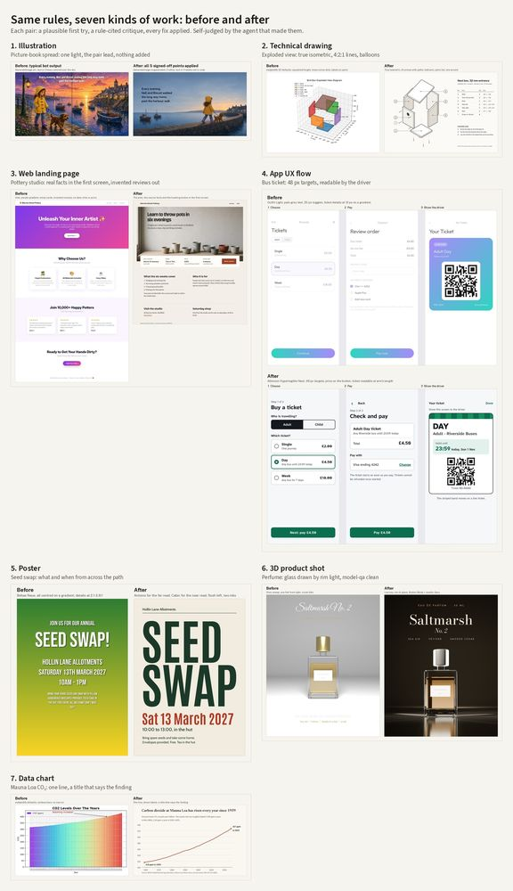

# The aesthetic layer across domains

Seven worked examples, one per kind of work: illustration, technical drawing, a web landing page, a three-screen app flow, a type-only poster, a 3D product shot and a data chart. Each has the same parts:

- a plausible **before**: what a bot usually produces for the brief with defaults and no further thought;
- a **critique** in the repo template (`core/critique-template.md`), with MEASURED findings (from a tool or a measurement; only these block) kept apart from INTERPRETED ones. Fixes are ranked and carry rule IDs, and the critique has an *Additions* line and the FLOW-1 to FLOW-5 sign-off blurb as it would be sent;
- an **after** with every signed-off point applied, and a delivery checklist in the example's README;
- a labelled **side-by-side**.

Every brief, business and product here is made up. All the work is self-judged by the agent that made it, so these are worked examples, not evidence. Each example says how it was made (code, Blender or GenerateImage) and which fonts it uses and why (TYPE-10). Each one also has a *What went wrong on the way* section.

| # | Example | Made with | Type after (TYPE-10) | Main findings (before) | After |
|---|---|---|---|---|---|
| 1 | [Illustration: picture-book spread](illustration/) | GenerateImage + type in Pillow | Fredoka 500 | TD-LIT-1 two lights; text over the fold at 1.4:1 (LAY-5, TYPE-3); the sunset wins the blur test (CORE-3) | One light from the right, the pair against plain sky, muted palette; anatomy pass after every edit |
| 2 | [Technical drawing: nest box exploded view](technical-drawing/) | matplotlib, own isometric | Public Sans + Martian Mono | Height drawn at 0.675 of width (TD-PRO-1); screws as loose dots (CD-6); one line weight; 4 of 6 labels on parts | True isometric, lines 4:2:1 (ISO 128-2), balloons in columns (ISO 6433), parts list and steps |
| 3 | [Web landing page: pottery studio](web-landing/) | HTML/CSS, headless Chrome; generated hero photo | Bricolage Grotesque + Literata | Invented reviews and "10,000+" (CD-1, AES-10); no date, time or price (UX-1); grey text 2.54:1 | Course facts and Book in the first screen at 1280 and 390 px; all text 4.5:1 or better (worst, the headline over the photo at 390 px: 4.96:1) |
| 4 | [App UX flow: bus ticket](app-flow/) | HTML/CSS, headless Chrome | Atkinson Hyperlegible Next | Text 1.48-2.72:1 at 10-12 px; 18-25 px targets (UX-9); no date on the ticket (UX-1) | 48 px targets, price on both buttons, a ticket a driver can read at arm's length |
| 5 | [Poster: allotment seed swap](poster/) | Pillow, A3 at 150 dpi | Antonio + Cabin | Date and details 2.1-2.8:1 on a gradient; five invented phrases; date the same size as the venue (LAY-7) | Headline caps 110.6 mm, red date 30.6 mm; reads what and when at 10% |
| 6 | [3D product shot: perfume bottle](product-3d/) | Blender 4.2 Cycles + type in Pillow | Bodoni Moda + Josefin Sans | model-qa: base block through the glass, label floating (3D-1); 29.3% clipped (3D-7); small type 1.1-2.2:1 | Rim-lit glass on black, AgX, 0.57% clipped; model-qa 0 high; type 8.49:1 or better |
| 7 | [Data chart: Mauna Loa CO₂](data-chart/) | matplotlib, NOAA data | Newsreader + Source Sans 3 | No source (CD-1); "Alarming increase!" added; 67 year labels at about 7 px (TYPE-3); rainbow bars, 44 of 67 under 3:1 | One line, title states the finding (checked against the data), direct labels, source line |

Shared helpers are in [src/common.py](src/common.py) (font loading, contrast against the pixels behind text, side-by-side sheets). [src/make_overview.py](src/make_overview.py) builds the overview.

## What this shows, and what it doesn't
- The same short list of rules caught the main faults in all seven media. The faults that recur are text contrast, content the brief never gave, missing facts the user needs, and a first layout that ignores where the piece is seen.
- The measured findings did most of the blocking. The interpreted ones (mood, genericness, palette) drove most of the visible change, and each is labelled with its confidence.
- In every case the after is plainer or darker than the before in some way, and the comparison says so (AES-9 costs).
- Not shown: anyone other than the maker judging these. A blind comparison would need the protocol in [aesthetic-benchmark](../aesthetic-benchmark/).
