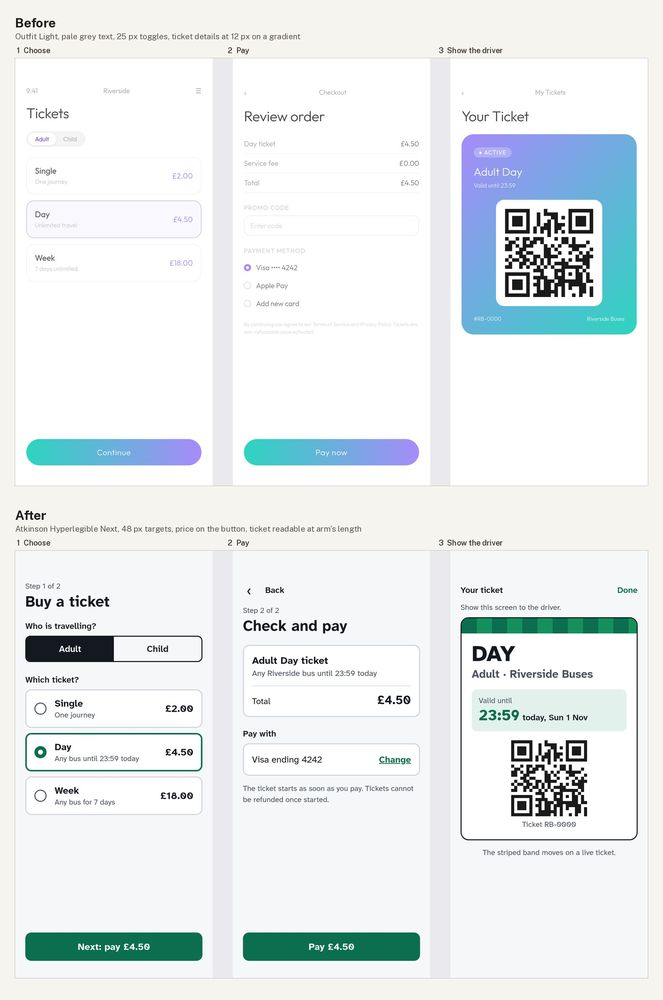

# App UX flow: buying a bus ticket (three screens)

**Made with:** hand-written HTML and CSS, three 390 x 844 screens per file, screenshotted in headless Chrome at 2x. QR codes are generated from a dummy string with `segno` (not a real ticket). Riverside Buses is made up. Self-judged by the agent that made it.
**Type:** before **Outfit** at weight 300 (a friendly geometric often picked for apps; its catalogue entry suits brand headings, and Light at 12 px is too faint for a public service). After **Atkinson Hyperlegible Next** 400-800 (`fonts/humanist-sans/atkinsonhyperlegiblenext/`), made for low-vision readers; the slashed zero is part of that design (TYPE-10).

[Full critique](critique.md) · screens: [before](src/before.html), [after](src/after.html) · look sheets: [before](look-before.jpg), [after](look-after.jpg)

## Delivery checklist (FLOW-3)
1. Contrast and size (UI-6, TYPE-3): **done.** Ink 16.60:1; secondary 7.37-7.90:1; button 6.25:1; green expiry on its tint 5.38:1; Done link 5.83:1. Smallest text 15 px. Before: 1.48-2.72:1 and 10-12 px.
2. Targets (UX-9, UI-5): **done.** Toggle 48 px tall, ticket rows 76 px (whole row), back 48 x 48, Change 48 px tall, Done 48 x 48, buttons 56 px.
3. Brief only (CD-1): **done.** Service-fee line, promo field, Apple Pay, "Add new card" and the terms line removed; the refund rule from the brief is stated in plain words.
4. Ticket for the driver (UX-1, CORE-1): **done.** "DAY" 44 px weight 800; "Valid until 23:59" 30 px, with "today, Sun 1 Nov"; moving band (striped, animated in production); code kept at 150 px; "Show this screen to the driver".
5. Price on the button, one colour for action (UX-2, UX-7, AES-2, AES-3): **done.** "Next: pay £4.50", "Pay £4.50"; green #0b6e4f for action and selection only. Blur grid now peaks on the buttons (2.3-2.5) and on the ticket's type and expiry (1.7-1.8), not a gradient.
- Type (TYPE-10): **done.**

QA re-run on the final screens: light not applicable (flat UI) · anatomy not applicable · contrast pass · targets pass · additions: labels only.

## What went wrong on the way
- The first after left "Done" on the ticket screen as small grey text with no target; caught on the target check and made a 48 px green link.
