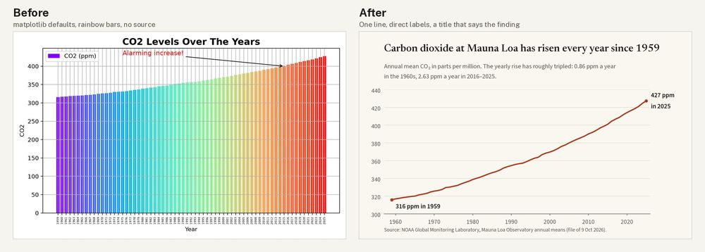

# Data chart: Mauna Loa carbon dioxide, 1959-2025

**Made with:** code only (matplotlib): [src/chart.py](src/chart.py) `before|after OUT.png`. The data is [src/co2_annmean_mlo.csv](src/co2_annmean_mlo.csv), NOAA Global Monitoring Laboratory annual means (public domain), retrieved 1 Nov 2026 (file dated 9 Oct 2026) [S162]. [src/make_fonts.py](src/make_fonts.py) makes static instances of the variable fonts, because matplotlib only uses a variable font's default instance. Self-judged by the agent that made it.
**Type:** before **DejaVu Sans** (matplotlib's default). After **Newsreader** 560 at optical size 36 for the title (`fonts/editorial-serif/newsreader/`, an editorial serif made for screen reading) and **Source Sans 3** 400/600 for everything else (`fonts/humanist-sans/sourcesans3/`, clear figures at small sizes) (TYPE-10).

[Full critique](critique.md) · look sheets: [before](look-before.jpg), [after](look-after.jpg)

## Delivery checklist (FLOW-3)
1. Source (CD-1): **done.** Source line under the chart.
2. Brief only (CD-1, AES-10): **done.** "Alarming increase!" removed. The title and subtitle are facts checked against the data (see Additions in the critique).
3. Tick size (TYPE-3, CORE-10): **done.** 7 decade ticks at 10.5 pt, about 15 px tall at 800 px wide. Before: 67 at 5 pt, rotated.
4. One line, fitted axis (CORE-3, CORE-6, AES-3): **done.** Rust #b23a1e at 5.58:1 on #faf7f1; axis 300-440 ppm; grid #e3ded4 horizontal only.
5. Title with the finding, direct labels (CORE-1, AES-2, CORE-8): **done.** No legend, no axis titles; the unit is in the subtitle.
6. Typesetting (TYPE-8): **done.** CO₂ subscript, en dash.
- Text contrast: ink #1f1d1a 15.72:1, soft #5c5852 6.61:1.

QA re-run on the final chart: light not applicable · anatomy not applicable · contrast pass · tick size pass · additions checked against the data.

## What went wrong on the way
- matplotlib drew Newsreader at its default weight and optical size. Static instances (fontTools instancer) fixed it.
- The first subtitle had loose line spacing (1.3), so it read as two separate notes. It is now 1.12.
