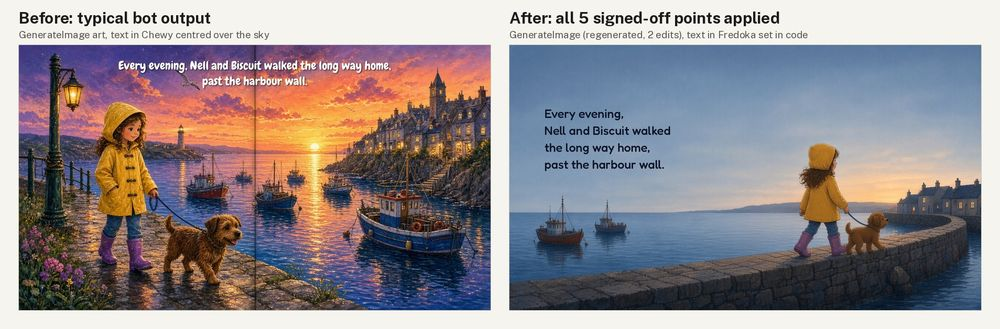

# Illustration: "The long way home" (picture-book spread)

**Made with:** GenerateImage (Grok Bot's built-in image model) for the art, all text set in code (Pillow). Before: one call from a typical bot prompt. After: one regeneration and three edits ([prompts](src/PROMPTS.md)). Self-judged by the agent that made it.
**Type:** before Chewy (a cartoon display face, a common pick for "kids"); after **Fredoka** at weight 500, catalogued for picture books and kids' apps (`fonts/childrens-playful/fredoka/`, TYPE-10). Chewy's catalogue entry says to avoid it for long text; this is a sentence read aloud.

[Full critique](critique.md) · [anatomy pass, after](anatomy-after/anatomy-pass.md) · look sheets: [before](look-before.jpg), [after](look-after.jpg)

## Delivery checklist (FLOW-3)
1. One key light (TD-LIT-1): **done.** Afterglow on the right horizon only; warm edge on the right of the hood and sleeve; no lamp; cottage windows are small motivated sources. Sun disc removed in round 2.
2. Text off the fold, readable (LAY-5, TYPE-3): **done.** Text x = 190-874 of 2560 (fold zone starts at 1126). Worst-pixel contrast 4.64:1 (mean 5.26:1) on the darkest line; before 1.41:1.
3. The pair lead (CORE-3, AES-2): **done.** Blur grid peak moved from the sun (2.6) to the figures' cell (2.4); the sky cells around them read 0.4-0.7.
4. Muted palette, one accent (ILL-11, AES-3): **done.** Mean chroma C* 29.2 -> 14.7; share above C* 40: 26.8% -> 1.5%.
5. The habit, not a show (AES-7, AES-6, AES-1): **done.** The wall leads to the cottages; they walk towards them and the page turn; lighthouse, gull, lamp, flowers and spires removed.
- Type (TYPE-10): **done.** Fredoka 500, flush left, leading 1.39.

QA re-run on the final art: light pass · anatomy pass (CHAR-9/10, re-run after each of the three edits) · type size and contrast pass · additions none.

## What went wrong on the way
- Round 1 put both characters walking left, away from home; the prompt said right. Rejected.
- Round 2 split the lead into a line in one hand and a closed loop in the other: the anatomy pass caught it at 4x (A7).
- Round 3 passed anatomy, but the dog stood on the fold; a fourth edit moved it. Each edit changed something else slightly (dog's size went down about 20%).
