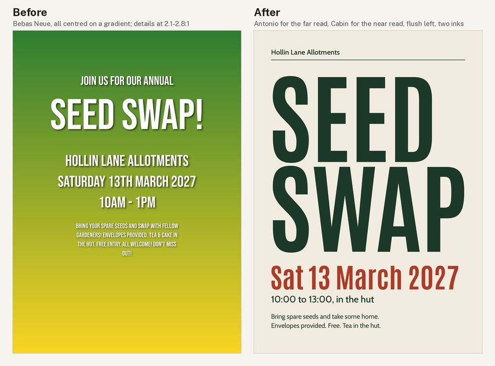
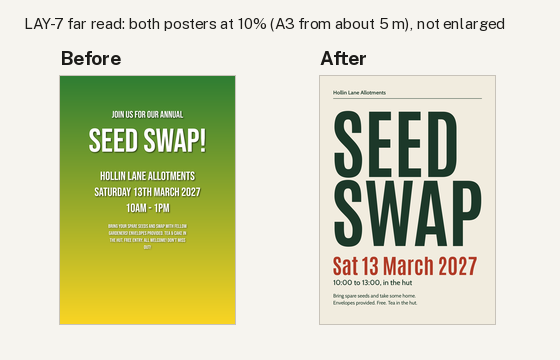

# Poster: allotment seed swap (type only, A3)

**Made with:** code only (Pillow), A3 portrait at 150 dpi: [src/make_before.py](src/make_before.py), [src/make_after.py](src/make_after.py). Hollin Lane Allotments is made up. Self-judged by the agent that made it.
**Type:** before **Bebas Neue** (caps-only condensed display face, a very common bot choice for posters). After **Antonio** 700 for headline and date (`fonts/condensed-poster/antonio/`, condensed with a real lower case, so the date can be in sentence case) and **Cabin** 400-600 for the details (`fonts/humanist-sans/cabin/`, catalogued for outdoorsy and craft brands) (TYPE-10).

[Full critique](critique.md) · look sheets: [before](look-before.jpg), [after](look-after.jpg)

## Delivery checklist (FLOW-3)
1. Contrast (UI-6, TYPE-3): **done.** Deep green #1c3829 on paper #f1ecdf 10.81:1; red #b03a26 5.12:1. Before: 2.09-3.67:1 on the gradient.
2. Brief only (CD-1, AES-10): **done.** "Annual", "cake", "All welcome!", "Don't miss out!" and "fellow gardeners" removed.
3. Three levels (LAY-7, CORE-1, AES-2): **done.** Headline caps 110.6 mm (before 39.8), date 30.6 mm in red (before 14.4 mm and the same as the venue), details 5.9 mm caps in one block. Blur grid peaks at 5.0 on the headline, 2.4-2.6 on the date; both read in `far-view.png`.
4. Grid and full height (LAY-1, LAY-2, CORE-5, AES-1): **done.** 12 columns, 22 mm margins, everything flush left on the first column; text runs to the bottom margin.
5. Sentence case, two inks (TYPE-6, TYPE-9, AES-3): **done.** No exclamation marks.
- Type (TYPE-10): **done.**

**Known issue (found later):** the brief's "Saturday 14 March 2027" is a Sunday. The light-touch fix kept the brief's wording and didn't check it. The fact check in the first-principles remake caught it (FP-3, [`../../first-principles-remake/`](../../first-principles-remake/)).

QA re-run on the final poster: light not applicable · anatomy not applicable · contrast pass · far-read pass · additions none.
