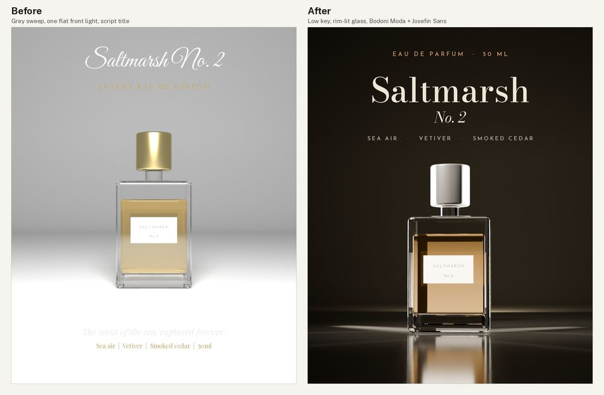

# 3D product shot: perfume bottle (Blender)

**Made with:** code only. The bottle and set are built from primitives in Blender 4.2 (Cycles, 256 samples) by [src/scene.py](src/scene.py); the same script makes both renders (`before` keeps the round-1 model, `after` the fixed one). [src/compose.py](src/compose.py) sets the type with Pillow. [src/make_font.py](src/make_font.py) makes a static, overlap-free copy of Josefin Sans for the label text inside Blender. Saltmarsh No. 2 is made up. Self-judged by the agent that made it.
**Type:** before **Great Vibes** + **Playfair Display** (the usual script-plus-didone "luxury" pairing). After **Bodoni Moda** 500 and italic for the name (`fonts/luxury-didone/bodonimoda/`: hairline didone catalogued for luxury and fragrance, echoing the rim lines on the glass) and **Josefin Sans** 500 in tracked capitals for the small lines (`fonts/art-deco-display/josefinsans/`: the same face as on the bottle label) (TYPE-10).

[Full critique](critique.md) · renders without type: [before](render-before.png), [after](render-after.png) · look sheets: [before](look-before.jpg), [after](look-after.jpg)

## Delivery checklist (FLOW-3)
1. Model (3D-1): **done.** model-qa on the bottle: round 1 had 3 high issues (base 2 mm through the glass floor, label and text floating, plus unwelded text); after: 0 high. Three medium issues remain, all intended: UV overlap and zero-area UVs on untextured glass and text.
2. Brief only (CD-1, AES-10): **done.** "LUXURY" and the tagline removed.
3. Contrast (UI-6, TYPE-3): **done.** Name 14.38:1, "No. 2" 13.79:1, notes 9.13:1, amber kicker 8.49:1 (mean of the render behind each line; worst pixel 8.35:1). Before: 1.13-2.23:1.
4. Light (3D-5, 3D-7, CORE-2): **done.** Black ground and world; rim strips at 16 W and 12 W; key 1.6 W from the upper left; fill 0.35 W; warm glow card behind the bottle, seen only through the glass. AgX "Medium High Contrast". Clipped pixels 29.3% before, 0.57% after (the rim highlights). Light check: the cap's left third is brightest (L 212, against 149 in the middle and 169 on the right), which matches the upper-left key. The rims light both edges, and the shadow side is to the right.
5. Camera (LAY-2, 3D-5): **done.** 85 mm, camera 40 mm up, shift so the bottle sits in the lower 60%; glossy black floor (base colour 0.015 linear, about 33 sRGB, inside 3D-6).
6. Type and accent (TYPE-9, AES-1): **done.** One amber accent (#dea562) taken from the liquid; the cap is black coated.

QA re-run on the final image: light pass · anatomy not applicable · contrast pass · clipping pass · additions none.

## What went wrong on the way
- Blender drew holes and spikes in the label text. The variable font has overlapping contours, so make_font.py instances a static weight with the overlaps removed (fontTools + skia-pathops).
- First before render was blown out; the light and world strength were lowered until it looked like a typical first try rather than a broken one.
- After render: the rim lights first made pools of light on the floor (they were raised and narrowed, and the floor made darker and glossier). The liquid read as nearly black with no light behind it, so a glow card was added. At first the card was too big and bright, giving a flat beige block, then it showed as a white bar in the headspace; it was shrunk, dimmed and lowered.
- The notes line was first set at the bottom, over the floor reflection; its worst pixel was 1.73:1, so it moved up into the dark top with the name.
- model-qa found the base block through the glass floor and the floating label only after the renders looked fine. That is the point of 3D-1.
