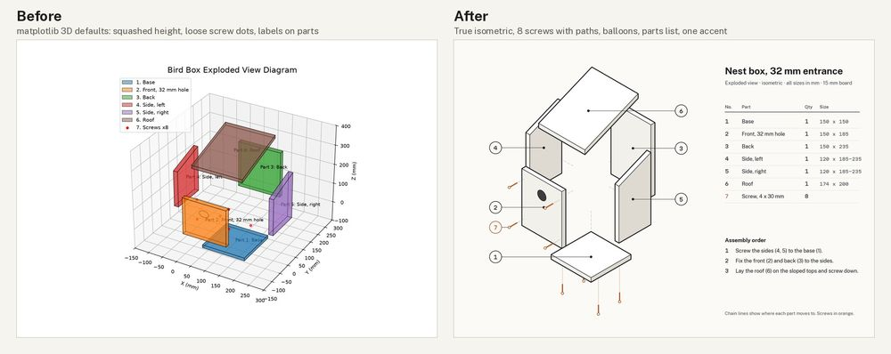

# Technical drawing: nest box exploded view (assembly sheet)

**Made with:** code only (matplotlib, 2D drawing of a hand-written 3D model in [src/geometry.py](src/geometry.py)). Before: [src/draw_before.py](src/draw_before.py), matplotlib's 3D axes with defaults kept, the way a bot usually answers "draw an exploded view". After: [src/draw_after.py](src/draw_after.py), own isometric projection with back-face culling and depth sorting. Self-judged by the agent that made it.
**Type:** before DejaVu Sans (matplotlib's default). After **Public Sans** for title, list and notes (`fonts/grotesk-neutral/publicsans/`, neutral and legible, made for government documents) and **Martian Mono** for balloons and sizes (`fonts/monospace-code/martianmono/`), so digits line up in columns (TYPE-10). Static weights cut from the variable files with fontTools, because matplotlib otherwise loads the variable font's default weight.

[Full critique](critique.md) · look sheets: [before](look-before.jpg), [after](look-after.jpg)

## Delivery checklist (FLOW-3)
1. True proportions (TD-PRO-1): **done.** Isometric, equal scale on x, y, z; the back panel (150 x 235) now draws 1.57 times taller than wide, as it should (before: about 1.06).
2. Screws placed (CD-6): **done.** All 8 drawn as screws aimed at their holes (4 into the front, 4 up through the base) with dotted paths; balloon 7, quantity 8 in the list.
3. Line hierarchy, solid faces (CORE-1, AES-5, AES-4): **done.** Outline 1.8 pt, edges 0.9 pt, chain lines and rules 0.45 pt (4:2:1). Faces opaque: top #ffffff, front #f2f0ea, side #dedad1 (light from upper left, TD-LIT-1). Axes, grid, legend gone.
4. Balloons (CORE-5, TYPE-3, ISO 6433): **done.** Seven balloons in two aligned columns, leaders end on a dot inside each part, minimum spacing 44 px; no text on parts.
5. One accent, list and order (AES-3, CORE-6, CD-6): **done.** Orange #b4541b only for screws (4.76:1 on the paper); grey text #4a4d50 at 8.15:1; chain grey 3.20:1 (non-text, needs 3:1). Parts list with sizes and three assembly steps added from the brief.
- Type (TYPE-10): **done.** Public Sans 400/600/700, Martian Mono 400.

QA re-run on the final sheet: light pass (one direction for all face tones) · anatomy not applicable · contrast pass · additions: only what the brief asked for.

## What went wrong on the way
- First isometric looked from the wrong corner (back faces showing). Fixed by building the view basis from one view direction.
- Base screws were hidden behind the front panel; the base was exploded further down so all 8 screws show.
- matplotlib loaded Public Sans at Thin 100 (the variable default) until static instances were cut.
