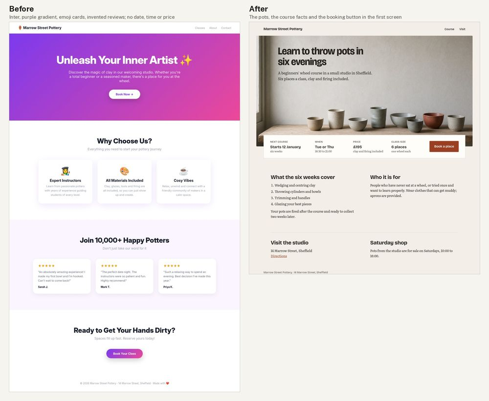
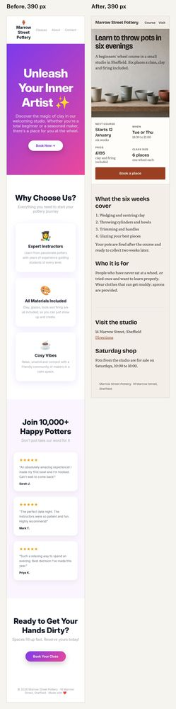

# Web landing page: Marrow Street Pottery (made-up studio)

**Made with:** hand-written HTML and CSS, screenshotted in headless Chrome at 1280 px, 390 px and 200% zoom ([src/shot.sh](src/shot.sh)). The after's hero photo is generated (GenerateImage, prompt in [src/PROMPTS.md](src/PROMPTS.md)) and stands in for the studio's own photo. Before written the way a bot answers "make a landing page for my pottery studio" with no facts pasted in. Self-judged by the agent that made it.
**Type:** before Inter, all weights, centred (TYPE-9 and UI-7 name it as a default tell when used for everything). After **Bricolage Grotesque** for headings, labels and the button (`fonts/grotesk-neutral/bricolagegrotesque/`, opsz 96, wdth 92 for the headline: hand-made feel without being cute) and **Literata** for reading text (`fonts/editorial-serif/literata/`, the catalogue's suggested pair; sturdy at small sizes) (TYPE-10).

[Full critique](critique.md) · pages: [before](src/before.html), [after](src/after.html) · look sheets: [before](look-before.jpg), [after](look-after.jpg) · 200% zoom: [before](before-zoom200.png), [after](after-zoom200.png)

## Delivery checklist (FLOW-3)
1. Only the brief's claims (CD-1, AES-10): **done.** Reviews, names, stars, "10,000+", "Expert Instructors", "glazes and tools" and "Spaces fill up fast" removed. Every sentence traces to the brief.
2. Decide and book in the first screen (UX-1, CD-6, UI-4): **done.** Start date, days and time, price, class size and "Book a place" sit in one strip; it ends at y = 755 of an 800 px laptop screen, and is fully visible at 200% zoom and at 390 px.
3. Contrast (UI-6): **done.** Ink on paper 13.98:1; secondary text 6.83-7.71:1; button 6.76:1; link 5.90:1. Text on the photo, measured against the worst pixel behind it with the text hidden: headline 6.56:1 (390 px: 4.96:1), intro 6.89:1. Before: 2.54:1 and 2.75:1.
4. Show the studio, one accent (UI-7, AES-6, AES-7, CORE-3): **done.** Photo of pots on a shelf, single window light from the left; button rust #9a3f22 taken from the one red bowl. Blur grid now peaks on the headline and the strip (2.1-2.5) instead of the gradient.
5. Type and alignment (TYPE-9, TYPE-10, UI-1): **done.** Bricolage Grotesque 500-700, Literata 400, left-aligned, reading columns under 70 characters.

QA re-run on the final page: light pass (photo: one window, left) · anatomy not applicable · contrast pass · 200% zoom pass · additions: the placeholder photo only.

## What went wrong on the way
- First after placed the intro over the dark window frame on the left of the photo; moved the copy right and set it in full ink.
