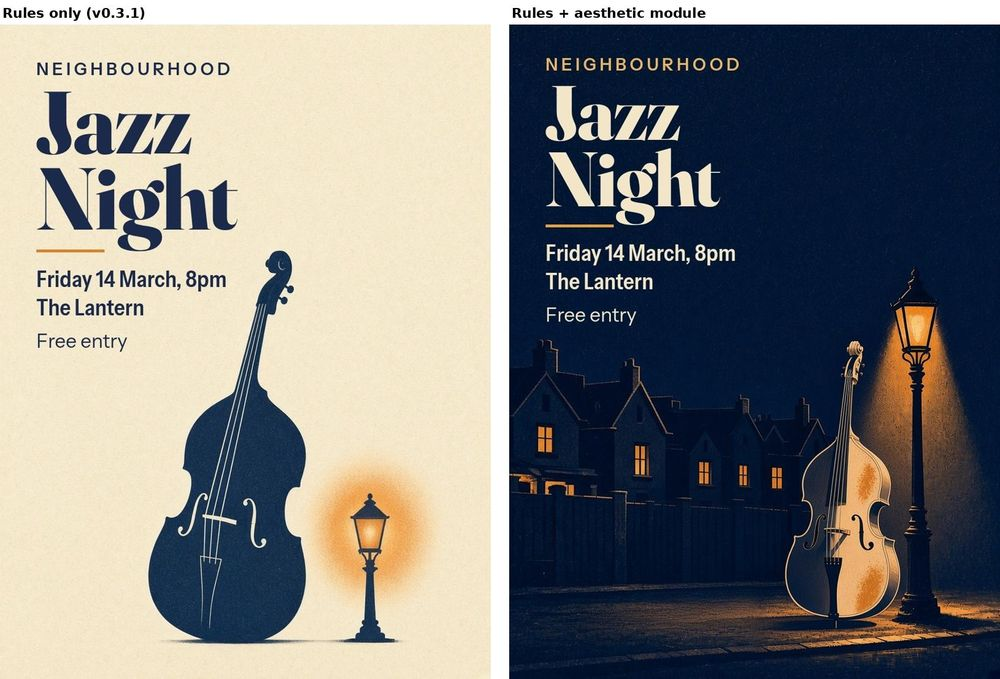

# Aesthetic benchmark

Does the aesthetic layer (`modules/aesthetic-critique/`) help produce work people prefer, while keeping the brief and passing the measured checks? If it only adds vocabulary, it has failed. This folder holds a protocol for testing that properly, and two small demos that are **not** tests.

> **Unequal effort in everything shown here.** In the two demos below and in the [reference set](reference-set/), the rules + aesthetic version always had **one more round of work** than the rules-only version. Part of any gain may come from that extra round. The protocol now requires equal rounds.

## Protocol

**Run 01 was turned into an open, labelled [reference set](reference-set/) (12 pieces, key published), so it is no longer blind.** A later blind run using this protocol is optional.

**Conditions.** Same model, same briefs, same tools, same round limit.
- **A:** `core/` plus the medium's modules (rules only).
- **B:** A plus `modules/aesthetic-critique/`.

**Briefs.** At least 12, spread across media and moods: a poster, a book cover, a logo, an ink illustration, a product render, a landing page, a social card, a character, a calm piece, a loud one, a deliberately rough one, a deliberately rule-breaking one. Write each brief once and freeze it.

**Blinding.** Strip file names and labels; give each output a random ID; randomise left/right per pair and show each pair twice with sides swapped. Judges see the brief and the two images only, never the critique or which condition made what. Commit a hash of the answer key (with a random salt, since 12 left/right choices are only 4,096 combinations) before judging, and publish the key afterwards.

**Same start, equal effort (required).** Both conditions start from the same generation or file and get **the same number of rounds** and the same image-generation budget. If B is made as a revision of A, A gets an equal extra round with rules only. A comparison where one side had more rounds is not a valid result under this protocol; report it only as a showcase (run 01 and the demos below are in that category).

**No added story.** B may restyle what the brief gives but may not add characters, creatures, objects, text or claims without room in the brief or owner sign-off ([AES-10](../../modules/aesthetic-critique/README.md#aes-10-revision-with-regression-check)). Judges should be told to mark any addition they notice.

**Judges.** At least 5 people who did not make the work; ideally a mix of designers and the target audience. Agreement among independent judges is the standard check for creative quality [S145]. A model judge may be added as an extra rater but is reported separately, because model judges show position and self-preference bias [S146].

**Measures.**

| Measure | How |
|---|---|
| Pairwise preference | Per pair: A, B or "neither is good enough"; then strong or marginal. Report the win rate with a confidence interval. Pairwise comparison is more reliable than rating scales [S143, S144]. |
| Brief fidelity | Per image: does it meet the frozen brief and must-keeps? yes / partly / no |
| Distinctiveness | Per pair: which is more specific to this brief and less interchangeable? |
| Coherence | Per pair: which reads as one art direction? |
| Revision success | Original vs revised, judged blind (below): share of revisions preferred |
| Regression rate | Share of revisions that break a measured check (contrast, type size, collision, anatomy, safe area) that the previous round passed |
| Technical compliance | Measured blockers per image, from the repo's tools (not judged) |
| Inter-rater agreement | Krippendorff's alpha on the pairwise choices [S148]; report it, and treat preferences with low agreement as taste, not quality |

**Blind revision test.** For each B piece, show judges the original and the revised version (sides randomised), without the critique. If judges can't tell or prefer the original, the revision loop isn't helping, however good the critique reads.

**Report honestly.** Report all briefs, including losses, the "neither" rate and any brief where B made things worse. Don't drop a brief after seeing the result.

## Demo: one sample, self-judged (1 November 2026)

**Not evidence.** One brief, one generated image, judged by the same agent that made it and that wrote the module. It only shows the procedure working end to end.

**Starting point.** The v0.3.1 with-skill jazz poster ([`../baseline-comparison/poster-with.jpg`](../baseline-comparison/poster-with.jpg)), which passed every blocker but lost to the without-skill version on atmosphere.

**AES-0 intent.** Purpose: get neighbours to a free jazz night [brief]. Audience: local residents [brief]. Facts: Friday 14 March, 8pm, The Lantern, free entry [brief]. Mood: warm, evening, inviting [inferred]. Style: two-colour screen print [inferred from v0.3.1]. Focal experience: "a night out on my street" [inferred]. Polish: clean print finish [inferred]. Must-keeps: the facts, legibility, reading order what, when, where, price.

**Diagnosis (interpreted).**
- AES-7 / AES-3: cream paper everywhere and a daylight value range; nothing says *night*. Effect: reads as a catalogue page, not an evening out.
- AES-6: a bass and a lamp on blank paper could be any music event anywhere; nothing says *neighbourhood*.
- AES-1: the lamp is drawn about knee height next to the bass, an odd scale that breaks the scene.

**Two changes (AES-10).** (1) Make it night: navy ground, warm amber light, cream type. (2) Put it on a street: terraced rooftops with lit windows, a lamp at true scale. One GenerateImage call for the text-free art ([prompt](src/PROMPTS.md)); all type set in code with the same fonts and facts ([`src/compose.py`](src/compose.py)).

| Round | Change | Result |
|---|---|---|
| [r1](poster-aes-r1.jpg) | New night art; type reversed to cream, title 150 px | "Free entry" sat close to the bass scroll and the chimneys: a near-tangent |
| [r2](poster-aes-r2.jpg) (final) | Title 150 -> 136 px, block 8 px higher | Clear gap above the scene |

**Measured (`tools/contrast.py`).** Cream title on the sky 13.89:1 (needs 3:1); facts 13.86:1 (needs 4.5:1); amber kicker 9.22:1. Against the lightest grain pixel in each area (a deliberately harsh check): title 7.02:1, facts 8.00:1, kicker 4.66:1. All pass. Facts and reading order unchanged. [Look sheet](look-poster-aes.jpg).

**Pairwise verdict (AES-9, self-judged, checked with sides swapped).**
- **Stronger for this brief:** B (rules plus aesthetic module). **Preference:** strong on atmosphere; it held with sides swapped.
- **Strongest difference:** B says *a night on your street* at thumbnail size; A says *a music event*.
- **Caused by:** dark ground with one warm light source; a specific place (terraces, lit windows); the lamp at believable scale.
- **Cost:** B is darker and busier in its lower half and loses some of A's clean, print-like calm. At the blur test the bass and lamp lead and the title comes second; on a poster the title should arguably lead at distance (LAY-7), so this is a real trade-off for the owner. A is the safer choice if the venue wants a quiet, typographic look.
- **Honest misses in B (unfixed, fails TD-LIT-1):** the bass stands outside the drawn cone of lamplight yet is brightly lit, a second, unexplained light; the generated bass also has a violin-like waist and sharp corners rather than a double bass's sloped shoulders. A second image edit (1 Nov review) asked for the bass inside the cone with double-bass proportions; the generator instead mirrored the lamp to the left, left the bass outside the cone and kept the violin shape ([rejected attempt](src/poster-art-night-attempt2-rejected.jpg)). It also put the lamp head into the type area. So the poster keeps the first art and the fault is captioned in the README hero.
- **Added content (AES-10):** the terraced rooftops, lit windows and street are a setting the brief didn't specify; they were inferred from "neighbourhood". Under the current rule they should be marked [inferred] and confirmed with the owner.
- **Against the original without-skill poster:** similar atmosphere; B keeps the v0.3.1 gains in accuracy (no invented address or slogans) and legibility.

What this demo can't show: whether other people agree, whether it generalises beyond one poster, or whether rules alone with a better prompt would have done the same. That is what the protocol above is for.

## Fox cover: second sample, self-judged (1 November 2026, revised after review)

**Not evidence either.** The v0.3.1 with-skill fox cover ([`../baseline-comparison/fox-with.jpg`](../baseline-comparison/fox-with.jpg)) was correct but pale next to the busy without-skill cover. AES-0: picture book for ages 4-7 [brief], mood cosy and charming [inferred]. One change (AES-3, AES-7): golden-hour light with a warmer palette. Type re-set in code in warm cocoa with an italic *Reading* ([`src/compose_fox.py`](src/compose_fox.py)), same wording and placeholder author.

**Round 1 ([`fox-aes-r1.jpg`](fox-aes-r1.jpg)), withdrawn.** It also added a robin and fireflies (story content the brief didn't ask for, now against AES-10) and lit the fox's face from below with a glowing book while the sun sat low on the left: two key lights, a TD-LIT-1 blocker. An outside review caught both.

**Round 2 ([`fox-aes.jpg`](fox-aes.jpg), current).** One GenerateImage edit of round 1's art ([prompt](src/PROMPTS.md)): robin and fireflies removed, the book is plain paper with no glow, one key light from the low sun, fox about 15% larger.
- **Lighting (TD-LIT-1).** Mean grey level, sun side (left) vs far side (right): fox head 139 vs 120, fox body 117 vs 75, tree trunk 85 vs 47. All forms are lighter on the sun side; no light from below; the book catches light only on its left. Pass, with one caveat: the sun sits low and slightly behind the fox, so its front is lit more brightly than strict backlight would allow (read as soft sky fill).
- **Contrast (`tools/contrast.py`).** Title on the sky average 9.07:1 and on the 1st-percentile sky pixel under it 9.22:1 (needs 3:1); author 5.68:1 at worst (needs 4.5:1). Pass. The only darker pixels in the title box are 26 leaf-tip pixels at x 466-469, clear of the glyphs.
- **Look tests.** The fox now leads at the blur test; the low sun is second. [Look sheet](look-fox-aes.jpg).
- **Unfixed:** the scene is still a backlit sunset by design, so the fox has no strong rim light; the extra round means this column had one more round than the rules-only cover.
