# Reference set: rules vs rules + aesthetic layer (12 pieces)

An open, labelled showcase. Look and judge for yourself. It started as a blind A/B test; that was dropped and the set is now fully labelled, so it is **no longer blind**.

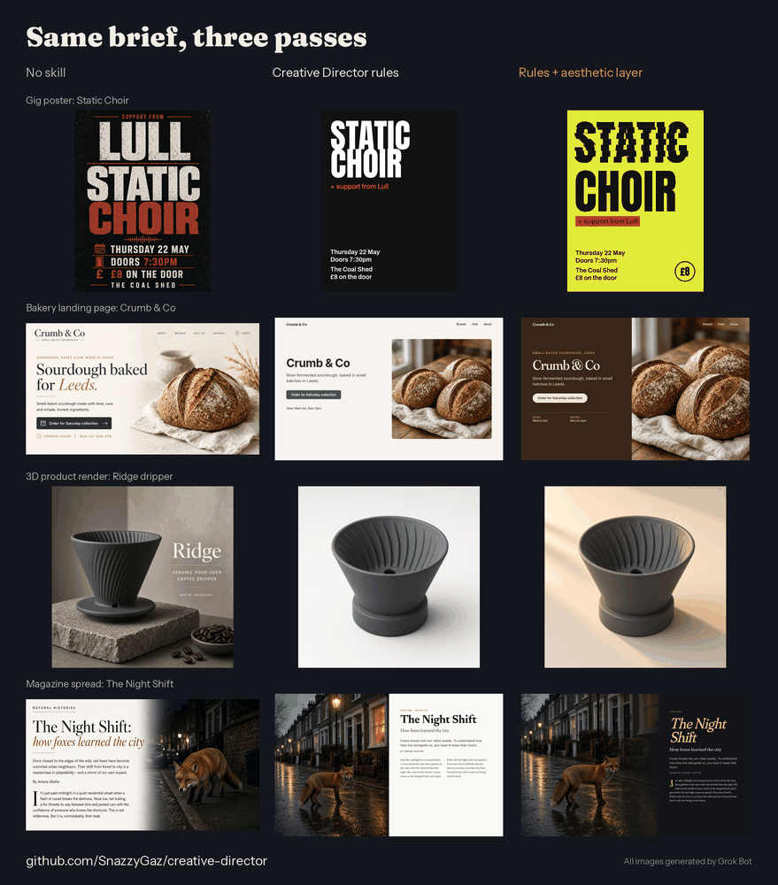

**Columns**
- **No skill** (pieces 02, 05, 08, 11 only): the same brief, generated or built with no Creative Director guidance.
- **Creative Director rules**: `core/` plus the medium's modules (v0.3.1 rules, no aesthetic layer).
- **Rules + aesthetic layer**: the same, plus [`modules/aesthetic-critique/`](../../../modules/aesthetic-critique/) (AES-0 to AES-10), started from the same generation or file.

> **Unequal effort: read before comparing.** The rules + aesthetic version of every piece had **one more round of work** than the rules-only version: it started from the rules version's first generation or file and then got an extra aesthetic pass. Some of its advantage may come from that extra round, not from the aesthetic layer. Future comparisons must give both conditions the same number of rounds (see the [protocol](../README.md#protocol)).

> **Added content (breaks the newer "restyle, don't add story" rule).** Pieces 01, 03, 04 and 12 (and 07, borderline) gained objects or story the brief didn't ask for. They were made before that rule existed ([AES-10](../../../modules/aesthetic-critique/README.md#aes-10-revision-with-regression-check)) and are kept as made, but labelled **Breaks AES-10** below. Under the current rule each addition needs room in the brief or the owner's sign-off.

**Also read this.** Everything here was made and judged by Grok Bot, which also wrote the aesthetic module, so this is a showcase, not evidence. The no-skill versions are already fairly polished; most changes are about restraint and the brief, not rescues. Several edits applied only partly (01, 03, 04, 12). All type is set in code; every text pair passes WCAG contrast in both versions.

| # | Piece | Brief | What changed / known flaws |
|---|---|---|---|
| 01 | **Calm poster: Moth Night** 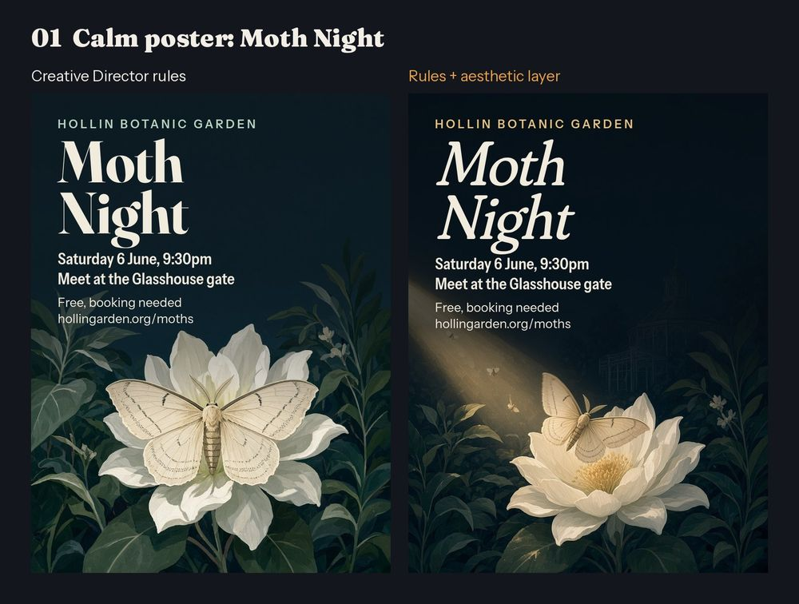 | After-dark moth walk poster, botanic garden, families. | Aesthetic pass added a torch beam, a moth in flight and a softer title. **Breaks AES-10:** the torch beam and the moth in flight are new objects the brief didn't ask for. Partial: the stronger scrim the beam needed hides most of the glasshouse. |
| 02 | **Loud poster: Static Choir** 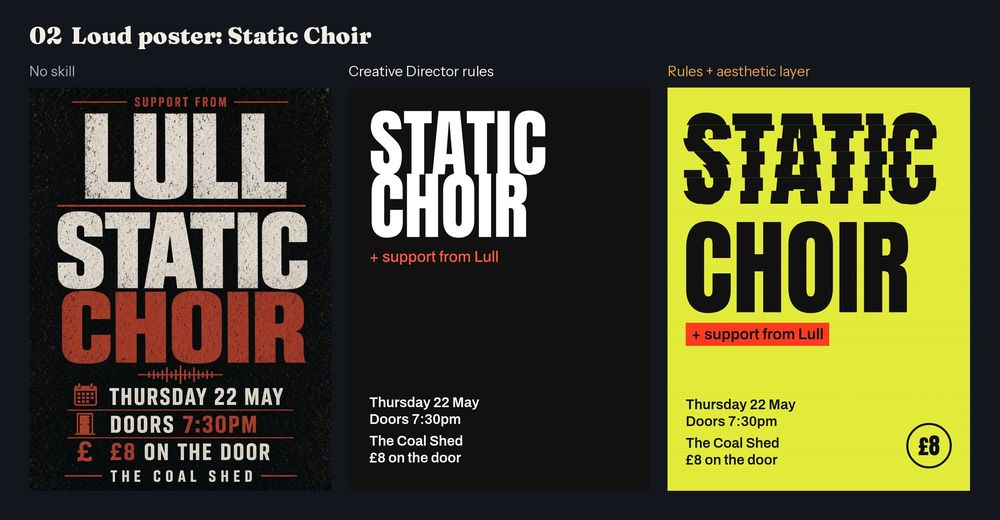 | Type-led noise-rock gig poster, support from Lull. | No-skill version makes the support act bigger than the headliner; rules fix the hierarchy; the aesthetic pass adds the "interference" slicing and acid ground. |
| 03 | **Ink illustration: The Last Keeper** 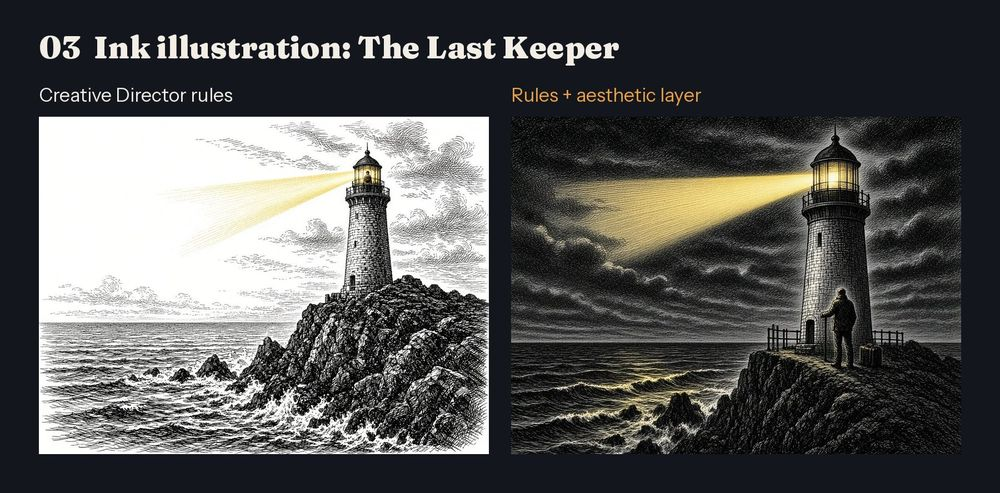 | Ink story opener: a lighthouse keeper's last night before automation. | Night sky and departing keeper added. **Breaks AES-10:** the suitcase and the departure scene are story the brief didn't give (it says "final night", not leaving). Partial edit: the keeper landed at the tower base, not on the gallery. |
| 04 | **Character: Bramble the badger** 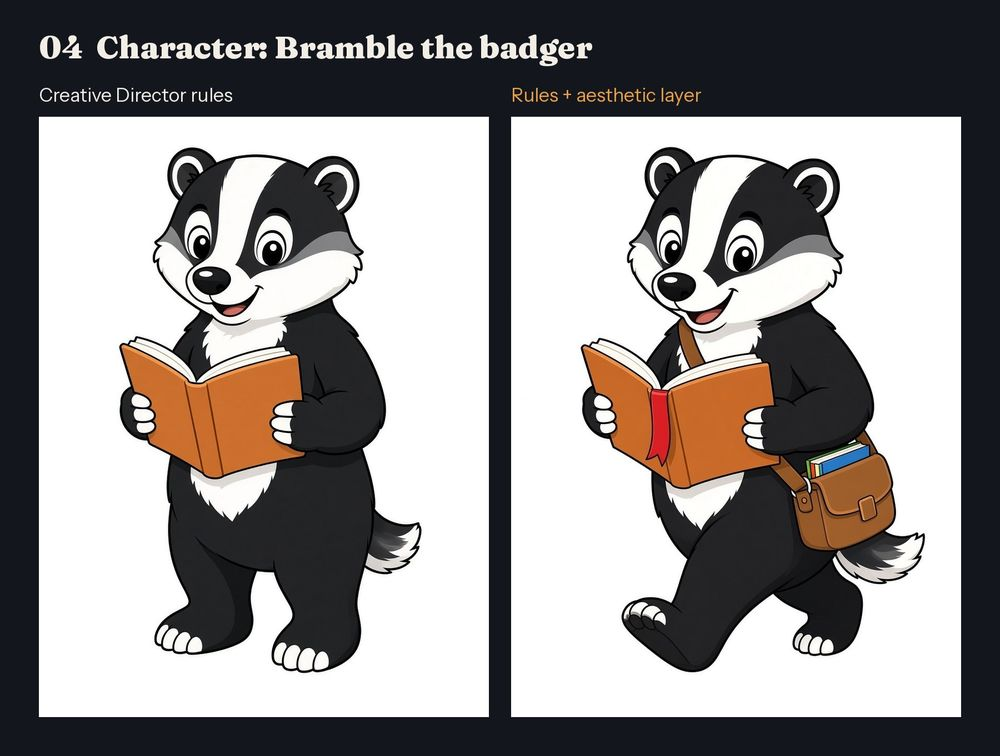 | Library reading-challenge badger mascot, prints small on stickers. | Pose, bookmark and satchel changed; the asked-for head shape change did not apply (still bear-like), and the satchel adds detail that prints poorly small. **Breaks AES-10:** the satchel and bookmark are new props the brief didn't ask for. |
| 05 | **Web page: Crumb & Co bakery** 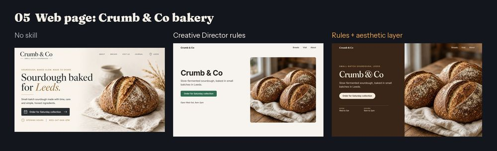 | Sourdough bakery landing hero with order button and hours. | Plain version already polished; the aesthetic pass takes the palette from the crust, full-bleed photo, hours as a schedule. |
| 06 | **App screen: Tally habit tracker** 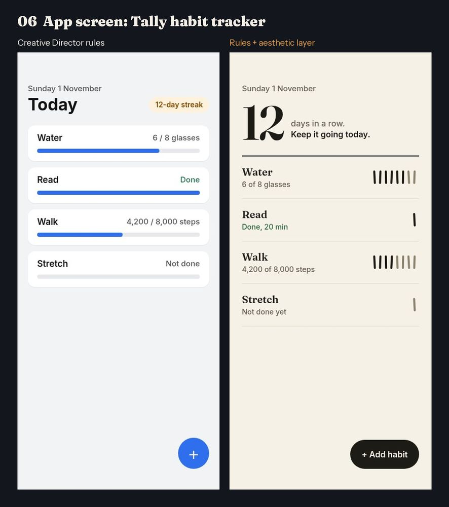 | Habit tracker "Today" screen with 4 habits and a 12-day streak. | Progress drawn as tally marks with the streak as hero number. Flaw: walk tallies round 4,200 steps down to 4 marks. |
| 07 | **Social card: Tern 2.0** 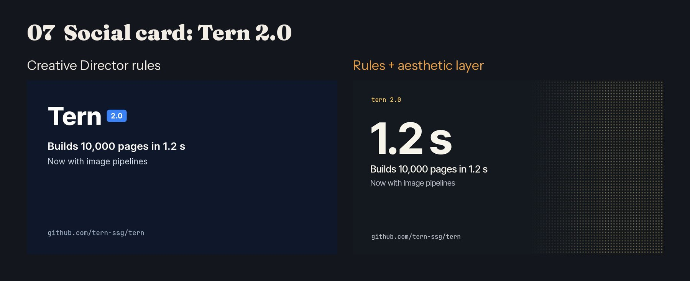 | Release card for a tiny static site generator. | "1.2 s" made the hero number with a dot field for 10,000 pages. **Borderline AES-10:** the dot field is a graphic stand-in, not an exact count of 10,000; it should be read as decoration, not a claim. |
| 08 | **3D render: Ridge dripper** 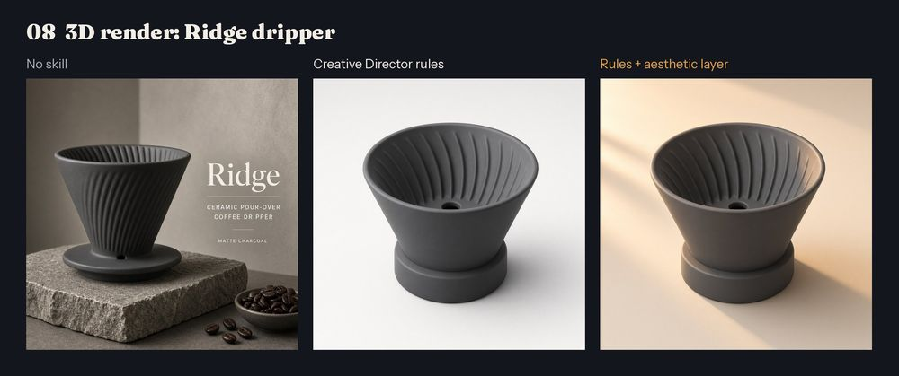 | Shop hero render of a charcoal ceramic pour-over dripper. | Plain version added product text and props the brief didn't ask for; the aesthetic pass adds warm window light and a rim highlight, shape held. |
| 09 | **Technical drawing: shelf bracket** 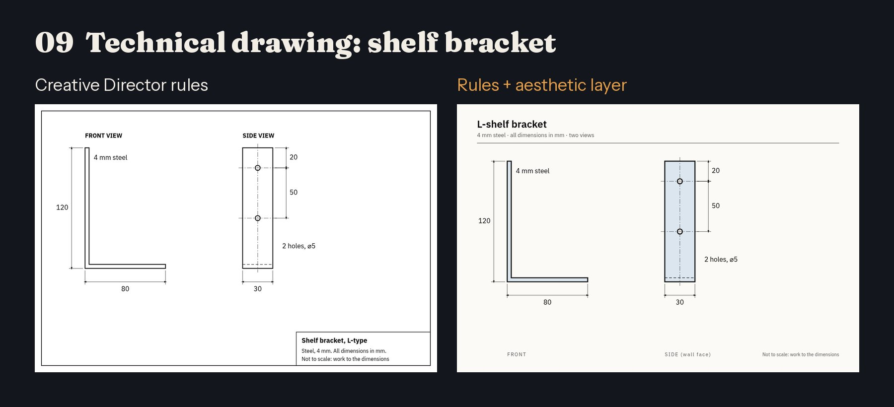 | Two-view dimensioned L-bracket for a DIY sheet. | Border and title block dropped, part tinted, outline heavier. A matter of taste whether this suits a DIY sheet. |
| 10 | **Logo lockup: Fernhill Coffee** 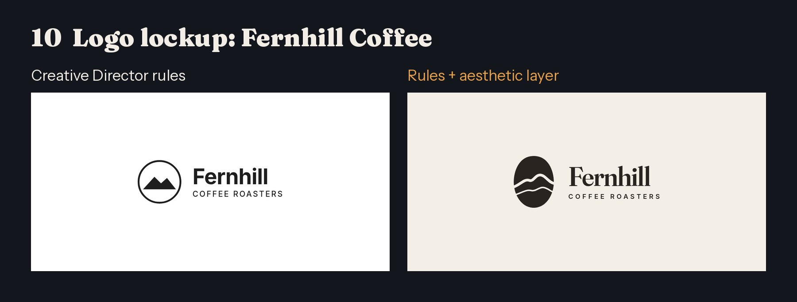 | One-colour logo lockup for a hill-town coffee roaster. | Generic circle-and-mountains mark replaced by a bean whose split is a hill ridge. |
| 11 | **Editorial spread: The Night Shift** 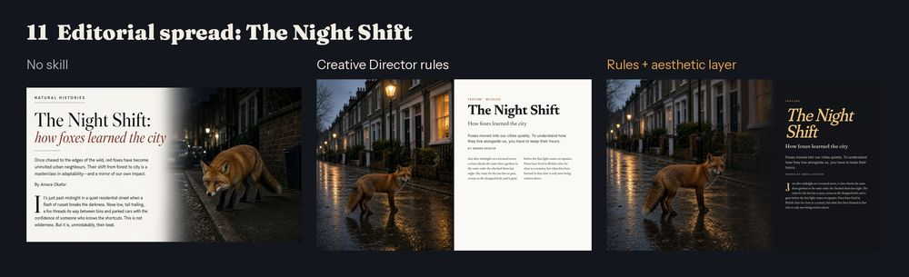 | Magazine opener about urban foxes, photo supplied. | Plain version already polished; the aesthetic pass goes to a dark night spread with an amber headline and a drop cap. |
| 12 | **Game concept: snowed-in observatory** 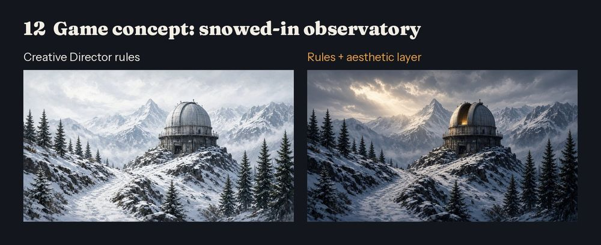 | Cozy game concept art: an abandoned observatory under snow. | Warm break in the clouds added. **Breaks AES-10 (borderline):** a glow inside the open dome hints that someone is in an observatory the brief calls abandoned. Partial: the light landed mostly in the sky and the dome is only partly warm. |

Full-size single images are in [`images/`](images/) (`NN-slug-rules.jpg`, `-rules-aes.jpg`, `-no-skill.jpg`). Full briefs: [`sources/briefs.md`](sources/briefs.md). Making log with every fix and regression: [`sources/MAKING-LOG.md`](sources/MAKING-LOG.md).

## The reveal (from the abandoned blind run)

- [`key.json`](key.json) is the original answer key; [`KEY-SHA256.txt`](KEY-SHA256.txt), committed before the key was published, holds its SHA-256 (`sha256sum key.json` should give `cfa3236e…`). The `A_sha256`/`B_sha256` values in it match the renamed images.
- The full sources archive (`sources.tar.gz`, 37 MB, hash also in `KEY-SHA256.txt`) is kept out of the repo for size; the briefs and making log above are taken from it unchanged.
- `blind.py` made the original shuffle; `build.py` makes the labelled sheets.
