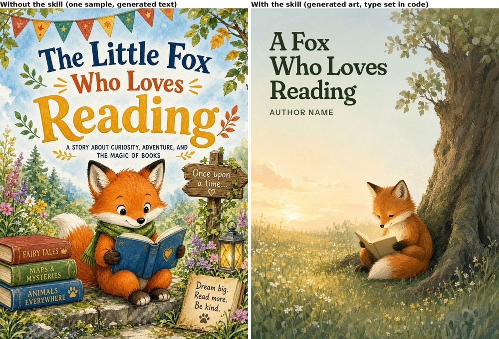
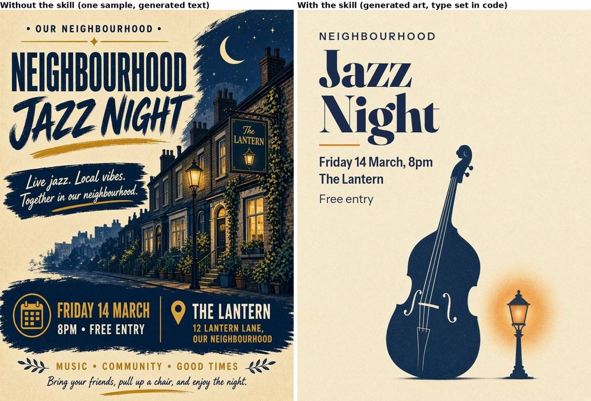

# Baseline comparison: same prompt, with and without the skill

**Model / tool:** both columns were made by **GenerateImage, Grok Bot's built-in image tool**, on the same day (1 Nov 2026), with the same aspect ratio (3:4). Nothing was retouched.

- **Without the skill:** the one-line prompt below, sent as is.
- **With the skill:** the same request run through `core/critique-loop.md` step 0 (brief) and the module rules, which turned it into a written prompt; then one round of look tests (`tools/look.py`) and a critique. No further rounds were run, to keep the cost down.

This is a small, single-tool test (two prompts, one sample each). Image models vary between runs, so treat it as an illustration, not a benchmark.

## 1. Children's book cover

Prompt: *"A cover illustration for a children's book about a fox who loves reading."*



| | Without | With |
|---|---|---|
| Invented text | Title "The Little Fox Who Loves Reading", a subtitle, three book spines, a signpost and a slogan card, none of which was asked for (CD-1, CORE-8) | None; the top third is left as plain sky for the real title |
| Focal point (ILL-2, CORE-1) | Fox competes with bunting, signpost, lantern, book stack and flowers | Fox and book are the only lit, hard-edged area; clear in the blur test |
| Palette (ILL-4, CORE-6) | Full saturated rainbow | Orange and page light against blue-violet |
| Weaker | | Darker and quieter; an owner might want something brighter for the age group (a question for the owner, not a rule failure) |

## 2. Event poster

Prompt: *"A poster for a neighbourhood jazz night on Friday 14 March at The Lantern, 8pm, free entry."*



| | Without | With |
|---|---|---|
| Facts | All four given facts present, plus an invented address ("12 Lantern Lane, Our Neighbourhood") and three invented slogans (CD-1, CORE-8) | Exactly the four facts, nothing else |
| Hierarchy (CORE-1, UI-9) | Title, slogan, date and footer all compete; "Our neighbourhood" appears three times | One reading order: what, when, where, price |
| Type (UI-1) | Four styles (spaced caps, condensed, brush script, handwriting) | Two (condensed display, plain sans) |
| Weaker | | Much plainer and less atmospheric. The amber "lamp glow" came out as a flat blob that reads as a second object, and it disappears in the greyscale test (same value as the paper), so it adds colour but not structure (ILL-3, CORE-2). The next round's fix would be: make the glow a soft radial light, or drop it. Not run. |

## What this shows, honestly

- The skill's biggest effect here is **restraint**: no invented facts, one focal point, fewer typefaces. That is what the rules ask for.
- It does not make the result more striking. The poster without the skill is, at a glance, the more attractive picture; it is also the less accurate one. Which matters more is the owner's call.
- A **web UI baseline** was not run. The same agent writing HTML "without the skill" would still have read the skill in this session, so it would not be a fair blind baseline. That needs a fresh session or another model (below).

## Cross-model runs wanted

No Claude, GPT or Gemini runs are included, because none were available for this batch, and faking them would defeat the point. If you can run one, please open a PR with the outputs labelled by model and date.

Without the skill, send the prompt alone. With the skill, load `SKILL.md` (or `lite/CREATIVE-DIRECTOR-LITE.md`) first, then send:

```
Using the creative-director skill, make: A cover illustration for a children's book about a fox who loves reading.
Follow the critique loop: write the brief first, run the look tests, cite rule IDs, max 3 fixes per round, and list honest misses.
```

(and the same with the jazz poster prompt). For a UI baseline: *"Build a single-file HTML landing page for a small bakery that sells sourdough by subscription."*, screenshot with `tools/shot.sh`, and run `tools/contrast.py` on both.
