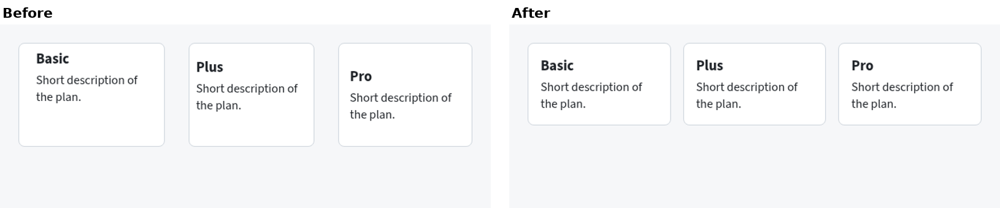
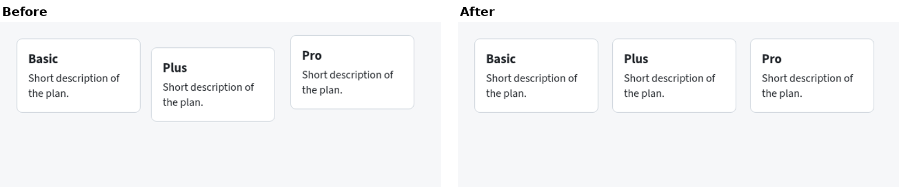
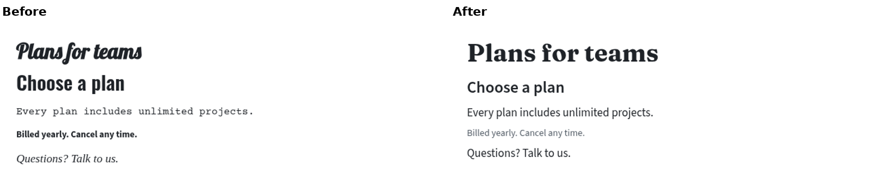
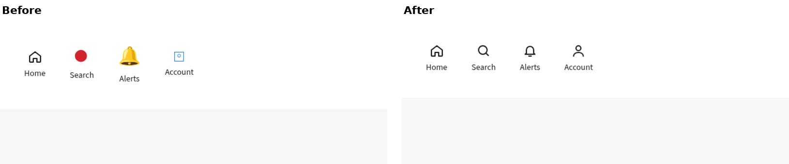
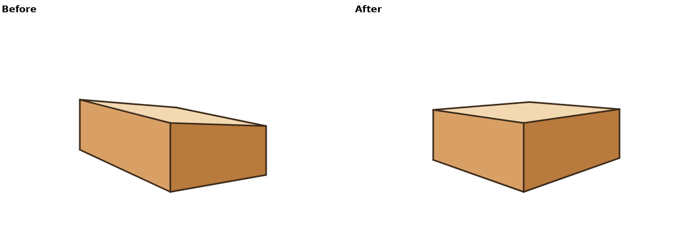
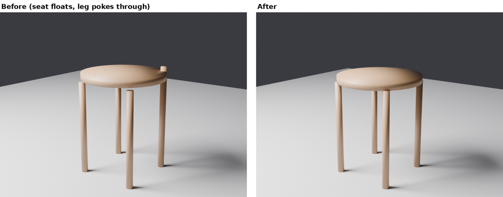

# Common agent failures: small single-round cases

Each case plants **one** common failure, runs one round of the loop, and checks the fix applied. All are made by code in this folder (`make.py` for the UI panels, `svg_box.py`, `stool.py` for Blender 4.2), so they can be rebuilt. Failures already covered by bigger examples are linked instead of repeated.

| Failure | Where | Rule(s) | Detected by |
|---|---|---|---|
| Low-contrast text | [web-ui-takeover](../web-ui-takeover/), [web-ui-landing](../web-ui-landing/) | UI-6 | tools/contrast.py |
| Broken mobile layout | [web-ui-takeover](../web-ui-takeover/) | UI-10, CORE-10 | tools/shot.sh at 390 px and 200% |
| Form with no field-level error states | [ux-signup-nudge](../ux-signup-nudge/) | UX-3, UX-7 | walkthrough with a typo |
| Inconsistent spacing / padding | here | UI-3, CORE-4 | CSS values read from code |
| Misaligned grid | here | CORE-5, UI-4 | box positions read from code |
| Clashing type scale | here | UI-1, CORE-7 | font list and sizes read from code |
| Mixed-style icon set | here | CORE-9, UI-5 | by eye at 2x, plus SVG attributes |
| SVG with wrong perspective | here | TD-PER-1 | tools/vp.py fit |
| 3D: floating and intersecting parts | here | 3D-1 | model-qa |

Criteria for every case: the rule IDs listed; the brief is "a pricing / nav / product component that keeps its content and colours". One round each; at most three changes; each fix checked after.

## Inconsistent spacing / padding

- **Detected:** UI-3, CORE-4 not met. Card padding 7/22, 18/9 and 30/14 px (three different values); gaps between cards 31 px horizontally, 5 px row gap. Card heights differ only because of padding.
- **Fix (1 change):** one padding (16 px) and one gap (16 px) from the spacing scale.
- **Verified:** after screenshot shows equal cards and equal gaps.

## Misaligned grid

- **Detected:** CORE-5, UI-4 not met. Card tops at y = 24, 37, 19 px; left edges at 24, 219, 421 px (steps of 195 and 202).
- **Fix (1 change):** shared top (24 px) and a 200 px column step.
- **Verified:** tops equal, steps equal in the after screenshot.

## Clashing type scale

- **Detected:** UI-1, CORE-7 not met. Five typefaces in five lines (Lobster, Oswald, Courier Prime, Source Sans 3, Georgia italic); sizes 31, 29, 15, 13.5, 17 px. The two headings differ by 2 px, so the step does not read; the smallest line is bold, so it competes with the body.
- **Fix (2 changes):** one display face plus one text face; a scale of 36 / 24 / 17 / 14 px with secondary text in a lighter grey instead of bold.
- **Verified:** after screenshot shows two faces and four clear steps.

## Mixed-style icon set

- **Detected:** CORE-9, UI-5 not met, judged at 2x zoom: one outline icon (2 px stroke), one solid red disc (which no longer reads as "search"), one colour emoji, one thin blue square (1 px stroke, 20 px). Four styles, three sizes, three colours.
- **Fix (1 change):** one outline set: 24 px, 2 px stroke, round caps, the text colour.
- **Verified:** SVG attributes identical across the four icons.
- **Note:** a solid set would meet the rule equally; the outline style was chosen only because the first icon already used it (CD-5: keep what was there).

## SVG with wrong perspective

- **Detected:** TD-PER-1 not met. `tools/vp.py fit svg-box-before.csv`: horizon tilt +8.26 deg, VPs 180 px apart in height. Verticals are fine (0.00 deg).
- **Fix (1 change):** both VPs on one horizon (y = 110).
- **Verified:** `vp.py fit svg-box-after.csv`: tilt +0.02 deg, mismatch 0 px.
- Endpoints come from the generating code (`svg_box.py`), so the measurement is exact; on a hand-made SVG, read them from the path data.

## 3D: floating and intersecting parts

- **Detected:** 3D-1 not met. `model-qa check --no-render --brief --profile render` (`qa-stool-before.txt`): 4 medium issues. Three NEAR_MISS_GAP ("touches nothing: 12.0 mm gap to nearest part 'seat'"). The over-long leg that pokes through the seat was reported only indirectly, as ASYMMETRY on leg0 ("max off 20.1 mm"); model-qa did not name it as an intersection.
- **Fix (2 changes):** seat lowered 12 mm onto the legs; leg0 cut to the same length as the others.
- **Verified:** `qa-stool-after.txt`: PASS, 0 high, 0 medium.
