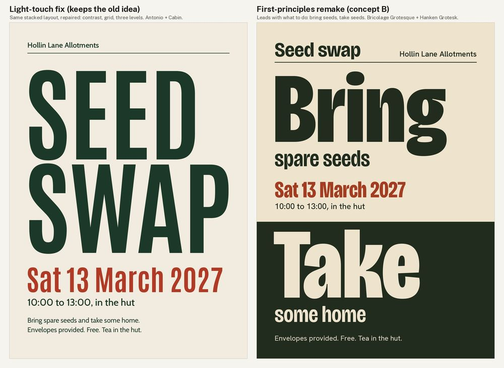
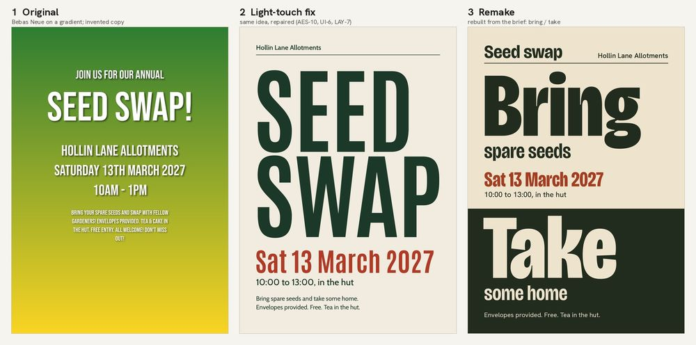
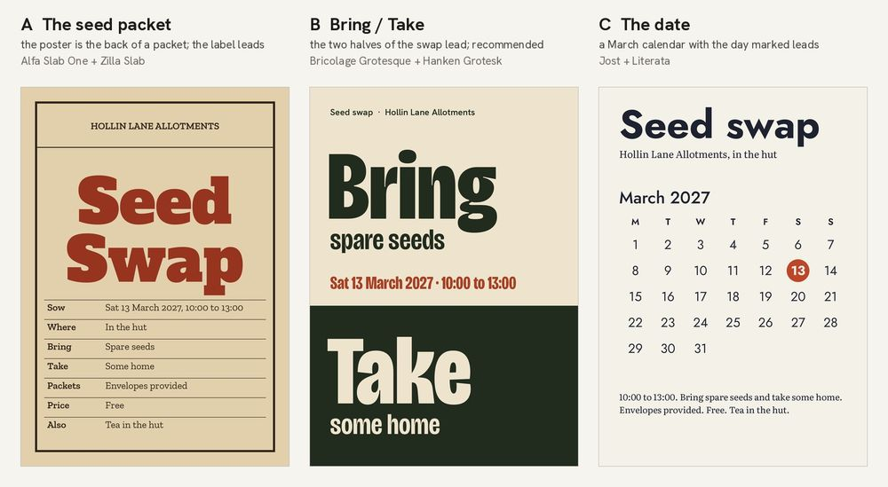
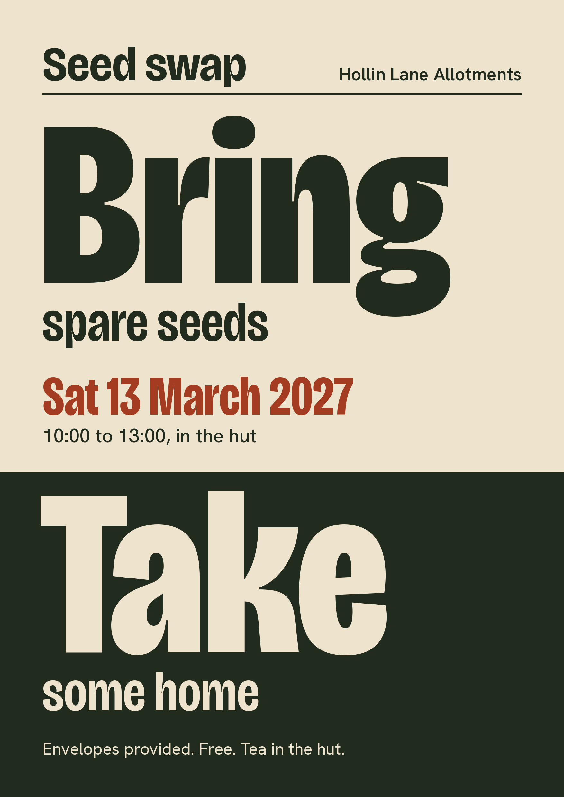
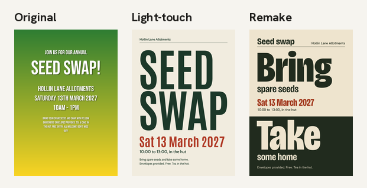

# First-principles remake: the seed-swap poster, rebuilt from the brief

**The ask:** "rejig it from scratch" (a trigger for `core/first-principles.md`, FP-1).
**Starting point:** the type-only A3 poster from [`../aesthetic-across-domains/poster/`](../aesthetic-across-domains/poster/). Its light-touch fix already repaired the contrast, cut the invented copy and set up three levels.
**Made with:** code only (Pillow), A3 portrait at 150 dpi:
- [src/make_concepts.py](src/make_concepts.py);
- [src/make_remake.py](src/make_remake.py);
- [src/make_sheets.py](src/make_sheets.py).

Hollin Lane Allotments is made up. **Self-judged by the agent that made it. No owner reviewed it**, so the brief is marked self-approved for the demo.

Why this one: it is the case where a rethink beats a polish. The light-touch fix made the poster correct. Stepping back asked what the poster is for. A swap only works if people bring seeds, and in both earlier versions "bring spare seeds" was small print.

## 1. Original and light-touch fix

## 2. Step back and brief (FP-2 to FP-4)
Full text: [brief.md](brief.md).
- **One job:** people come on the day **with spare seeds**.
- **Must survive:** every given fact word for word, type only, no invented copy.
- **Done when:** "what", "what to do" and "when" read at 10%.

The fact check (FP-3) transcribed every given fact and checked them against each other: the date and weekday agree (Saturday 13 March 2027), the times and place are consistent, and nothing was added.

## 3. Three concepts (FP-5, FP-6)

| | Idea (structure, not style) | Type | Result |
|---|---|---|---|
| A | The sheet is the back of a seed packet; the variety label leads, and the details are packet fields | Alfa Slab One + Zilla Slab | Dropped: its far read is the name alone, like the light-touch fix |
| B | The sheet splits into Bring (above) and Take (below, inverted); the action leads | Bricolage Grotesque + Hanken Grotesk | **Recommended and built** |
| C | A March calendar with the day marked; the date leads | Jost + Literata | Dropped: 30 of 31 numbers mean nothing, and the date already reads as one line |

## 4. The remake

Far read, each sheet at 10%:

[Full critique](critique.md) · [look sheet](look-remake.jpg)

## Delivery checklist (FLOW-3)
1. **Brief from first principles (FP-4):** **done.** Seven lines; no open fact questions.
2. **Facts, nothing added (FP-3, AES-10, CD-5):** **done.** Every given phrase appears word for word, including the full date.
3. **Concepts that differ in structure (FP-5):** **done.** Three concepts, and the structure test passes.
4. **Recommendation with reasons (FP-6):** **done.** B is built; A and C are dropped, with one line each.
5. **Contrast (UI-6, TYPE-3):** **done.** Ink on paper and paper on ink both measure 11.63:1. The date is 5.15:1, and it needs 3:1 as large text.
6. **Far read (LAY-7):** **done.** "Bring spare seeds / Take some home" and the date read at 10%.
   - Trade-off: the date and the event name are smaller than in the light-touch fix (20.5 mm vs 30.6 mm).
7. **Type (TYPE-10):** **done.** Fonts from `fonts/`, none used in the earlier versions, and not Fraunces.

QA re-run on the final render:
- light: n/a (flat two-ink print, no modelled light);
- anatomy: n/a (inventory: no people, hands or animals);
- contrast: pass;
- marks: none supplied, none present (BRAND-4, BRAND-8);
- additions: none.

**Three-way verdict (AES-9):**
- The remake is stronger for the brief's one job.
- The light-touch fix is stronger on "when" at distance.
- If the audience already knows the event, the light touch may have been enough. That is the owner's call.

**Questions for the owner:**
- Is the solid dark lower half acceptable for a home printer?
