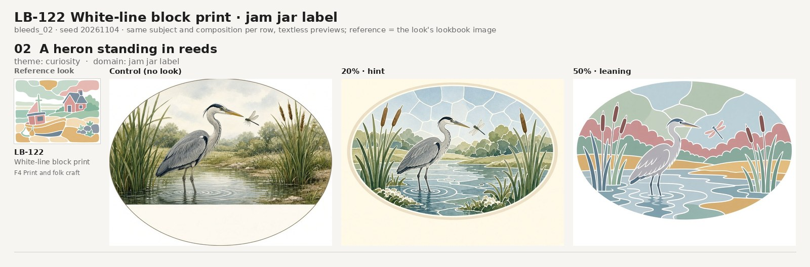
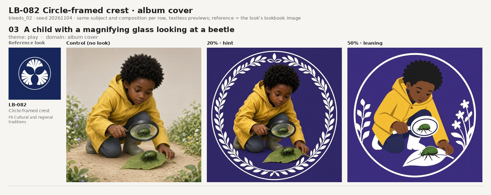
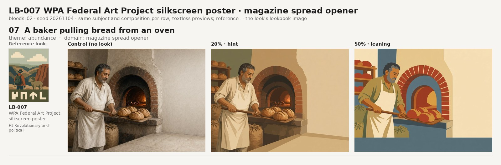
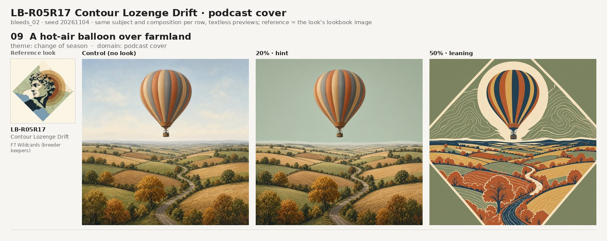
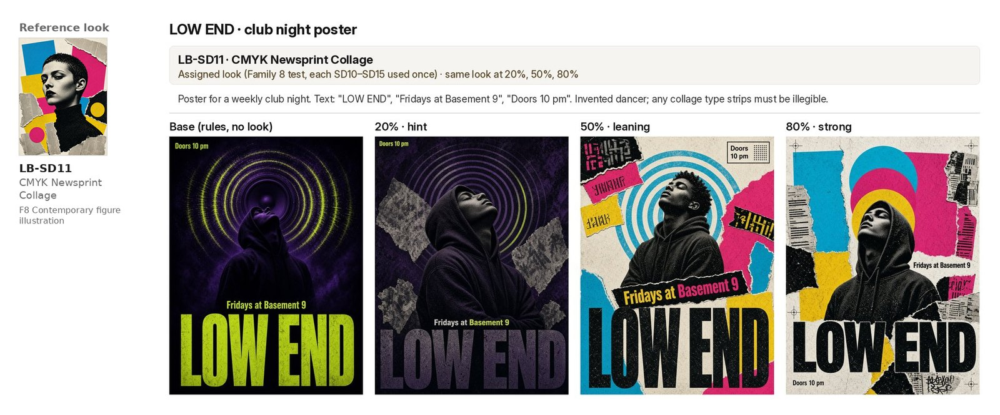
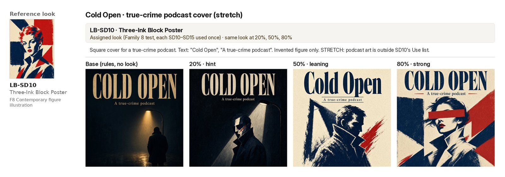
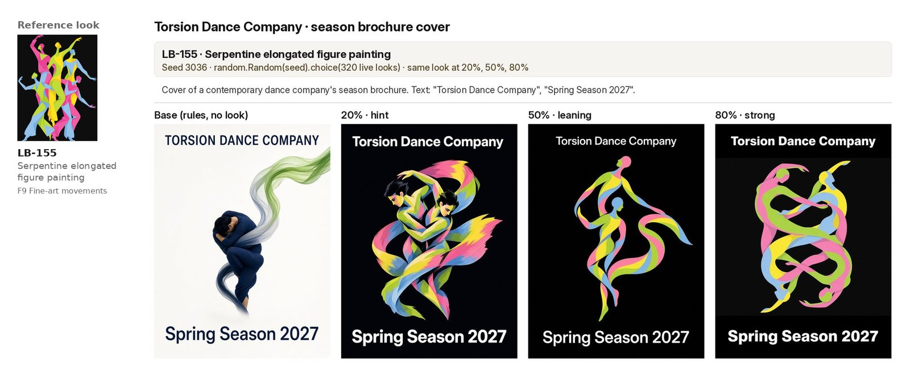

# Lookbook strength: how far to turn the dial

Three of the 21 sheets are below, with four textless rows from a later random set; the rest stay out of the repo. This is the internal evidence behind LOOK-1 to LOOK-3 (`modules/lookbook/README.md`). It is owner-judged, a small sample with one render per level, and not blind: treat it as craft wisdom, not a test result.

**How it was made** (v0.9.7, one image model). 21 invented briefs in varied domains, most with exact copy: posters, covers, labels, packaging, a stamp, a ticket, a tote, a skate deck, a web page, a product render, a chapter opener and others. Each brief got a **base** render (the full rules, no look) and three renders with **one** look at 20% (hint), 50% (leaning) and 80% (strong), as the strength dial defines them. Briefs 1-15 drew their look at random (`random.Random(seed).choice` over the 320 live looks, one seed per brief). Briefs 16-21 tested Family 8 (LB-SD10 to LB-SD15), one look each, two of them on briefs outside the look's `use` list. No real people. The best level per brief was picked by the agent and reviewed by the owner of the work, who judged 20-50% the sweet spot.

| Best level | Random pulls (1-15) | Family 8 (16-21) | All 21 |
|---|---|---|---|
| Base | 1 | 0 | 1 |
| 20% | 1 | 0 | 1 |
| 50% | 10 | 4 | 14 |
| 80% | 3 | 2 | 5 |

**What happened at 80%.**
- **It won where the look's structure was the brief's idea:** a game-box lid for a reading challenge, ribbon figures for a dance company called Torsion, a gallery statue glancing sideways for "Look Closer", a red poster block used as a redaction bar on a true-crime cover, and CMY circles used as speaker cones on a club poster.
- **Subject creep, 9 of 15 random pulls:** the look's own subject replaced the brief's: a crowd of creatures for a hedgehog mascot, icon-like figures on a choir ticket, a space shuttle for a skater, a fake desktop for a 404 page, among others.
- **Prop stripping, Family 8:** the family's subjects are generic (one figure, one animal, one portrait), so creep was milder, but 80% dropped the brief's props and twists to fit the look's single-subject formula (a suitcase, a quill, the lightning, the books).
- **Identity:** SD15 at 80% lightened an invented older woman's skin tone and features into its paper tone (LOOK-3).

**At 20%** the change was often too small to see; it won once, where one loud palette move was enough. Copy was exact on every render that carried text; words are by the image model, one render per level.

## Seven sheets

Each sheet starts with a small thumbnail of the [lookbook](../../modules/lookbook/) look doing the influencing, then that look applied to one brief at rising strength. The first four are textless previews: a control render (no look), then 20 and 50%. The last three are finished designs with copy: a base render (full rules, no look), then 20, 50 and 80%. LOOK-1 keeps looks at 20-50% by default; LOOK-2 allows 80% only when the look's structure carries the brief's idea, after a check that its subject hasn't crept in.

 **Heron Jar: 50% won.** 20% only showed the white lines once the prompt dropped the control as a reference, so the oval is a little different from the control. *(LB-122 White-line block print; a heron standing in reeds, theme curiosity.)*

 **Beetle Lens: 50% won,** and her skin holds at every level. All three versions have one flaw in common: the beetle in the lens is a second beetle, not the one on the leaf. *(LB-082 Circle-framed crest; a child with a magnifying glass looking at a beetle, theme play.)*

 **Baker: 50% won,** and his skin holds. The first 50% barely moved from the control and needed a reroll. *(LB-007 WPA Federal Art Project silkscreen poster; a baker pulling bread from an oven, theme abundance.)*

 **Balloon Season: 50% won.** No head crept in. *(LB-R05R17 Contour Lozenge Drift; a hot-air balloon over farmland, theme change of season.)*

 **LOW END: 80% won.** The look's CMY circles read as speaker cones and its type strips stay illegible; at 50% the scraps carried near-words. *(LB-SD11 CMYK Newsprint Collage.)*

 **Cold Open: 80% won, with creep.** The red block became a redaction bar across the eyes, right for true crime, but the brief's anonymous coat figure turned into the look's own glamorous woman. *(LB-SD10 Three-Ink Block Poster.)*

 **Torsion Dance: 80% won.** The look's structure is the brief's idea: figures wrung into one ribbon knot are the strongest read of "torsion". *(LB-155 Serpentine elongated figure painting.)*

Seven sheets, picked by the owner of the work, one kept render per level, not blind. The four textless rows come from a set of ten random bleeds (looks, subjects, themes and domains drawn at random); the three 20/50/80 rows are from the 21-sheet test.
