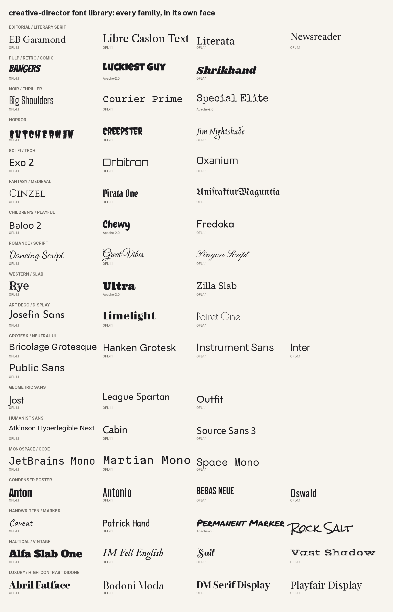

# Font library

61 free font families in 18 themes, so type can match a brief's genre instead of the same face turning up in every piece (TYPE-10 in [`modules/typography/`](../modules/typography/README.md#type-10-pick-type-from-the-theme-catalogue-to-suit-the-genre-dont-reuse-one-face-everywhere)).

- **[CATALOGUE.md](CATALOGUE.md):** per family, its themes, licence, axes or weights, what it's good for, what to avoid and what it pairs with. Same data as [`catalogue.json`](catalogue.json) for scripts.
- **Specimens:** one sheet per theme in [`specimens/`](specimens/) (sample line, weight range, pangram), plus the overview above.
- **Files:** `fonts/<theme>/<family>/`, each folder with its font files (variable versions where they exist) and its licence. Instrument Sans, used for the README images, stays in `docs/assets/src/fonts/` and is listed in the catalogue too.

## How to pick

1. Name the brief's genre and tone in a few words ("comic pulp romance", "quiet literary memoir", "cyberpunk game UI").
2. Open the matching theme's specimen sheet and catalogue rows. Families also listed under other themes are marked "also".
3. Pick one display face whose "good for" fits and whose "avoid" line your use doesn't break. Pair it with a text face from its "pairs with" list (TYPE-1: two families, each with a job).
4. Set it properly: one scale, real sizes, tracking, contrast (TYPE-2 to TYPE-6, UI-6).
5. Check you haven't used the same family in your last few unrelated pieces. Vary it.

A brand guide always wins over the catalogue (BRAND-3), and the face is a taste call for the owner of the work. The catalogue's notes are craft guidance written for this repo, not research findings; the research only says that readers do read personality into type (S156, S157 in [SOURCES.md](../SOURCES.md)).

## Themes

| Theme | For | Families (primary) |
|---|---|---|
| [Editorial / literary serif](specimens/editorial-serif.png) | Novels, essays, magazines, serious non-fiction. | EB Garamond, Libre Caslon Text, Literata, Newsreader |
| [Pulp / retro / comic](specimens/pulp-retro-comic.png) | Comic books, pulp paperbacks, comedy, loud retro. | Bangers, Luckiest Guy, Shrikhand |
| [Noir / thriller](specimens/noir-thriller.png) | Crime, spy, hard-boiled, case files. | Big Shoulders, Courier Prime, Special Elite |
| [Horror](specimens/horror.png) | B-movie, gothic, slasher, folk horror. | Butcherman, Creepster, Jim Nightshade |
| [Sci-fi / tech](specimens/scifi-tech.png) | Space, cyberpunk, games, tech products. | Exo 2, Orbitron, Oxanium |
| [Fantasy / medieval](specimens/fantasy-medieval.png) | Epic fantasy, myth, pirates, blackletter. | Cinzel, Pirata One, UnifrakturMaguntia |
| [Children's / playful](specimens/childrens-playful.png) | Picture books, kids' apps, friendly brands. | Baloo 2, Chewy, Fredoka |
| [Romance / script](specimens/romance-script.png) | Romance, weddings, formal invitations. | Dancing Script, Great Vibes, Pinyon Script |
| [Western / slab](specimens/western-slab.png) | Wild West, Americana, wanted posters. | Rye, Ultra, Zilla Slab |
| [Art Deco / display](specimens/art-deco-display.png) | 1920s-30s, jazz age, cinema marquees. | Josefin Sans, Limelight, Poiret One |
| [Grotesk / neutral UI](specimens/grotesk-neutral.png) | Interfaces, docs, quiet subtitles. | Bricolage Grotesque, Hanken Grotesk, Instrument Sans, Inter, Public Sans |
| [Geometric sans](specimens/geometric-sans.png) | Modernist, Bauhaus, brand headings. | Jost, League Spartan, Outfit |
| [Humanist sans](specimens/humanist-sans.png) | Warm, readable text and UI; accessibility. | Atkinson Hyperlegible Next, Cabin, Source Sans 3 |
| [Monospace / code](specimens/monospace-code.png) | Code, terminals, data labels, typewriter. | JetBrains Mono, Martian Mono, Space Mono |
| [Condensed poster](specimens/condensed-poster.png) | Film and gig posters, impact headlines. | Anton, Antonio, Bebas Neue, Oswald |
| [Handwritten / marker](specimens/handwritten-marker.png) | Notes, DIY, street, personal tone. | Caveat, Patrick Hand, Permanent Marker, Rock Salt |
| [Nautical / vintage](specimens/nautical-vintage.png) | Seafaring tales, old print, harbour signs, labels. | Alfa Slab One, IM Fell English, Sail, Vast Shadow |
| [Luxury / high-contrast didone](specimens/luxury-didone.png) | Fashion, perfume, classical, premium. | Abril Fatface, Bodoni Moda, DM Serif Display, Playfair Display |

## Licences

Every family is under the [SIL Open Font License 1.1](https://openfontlicense.org) or the Apache License 2.0. Both allow use in commercial work, embedding, and redistribution with the licence included; OFL fonts may not be sold on their own, and modified versions may not use a reserved font name [S154]. Each family's licence file sits next to its fonts. The files come unmodified from [github.com/google/fonts](https://github.com/google/fonts) (fetched 1 November 2026) [S155]. Skipped on purpose: large CJK families, and static weight sets where a variable font exists. Zilla Slab has no variable version, so only Regular, Italic, SemiBold and Bold are kept. Inter and Exo 2 are upright only.

## Rebuild

`python3 fonts/build.py` re-renders the specimen sheets and the tables in `CATALOGUE.md` from `catalogue.json` (Pillow only, no network). To add a family: put its folder (fonts and licence) under its theme, add an entry to `catalogue.json`, and re-run.
